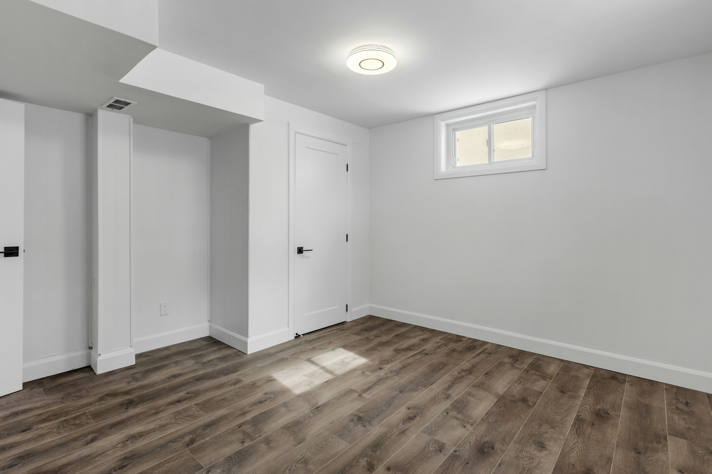

Since November 2022, Ontario has allowed up to three residential units on most urban residential lots as of right. The change came with the More Homes Built Faster Act, often called Bill 23, and it applies in Markham, Richmond Hill and Vaughan as much as in Toronto.

For homeowners, it means a basement apartment for a parent, a garden suite for an adult child, or a rental unit that helps with the mortgage can all be built legally without rezoning the property.

## What the provincial rules allow

On a lot with a detached house, semi-detached house or townhouse, in an area with full municipal water and sewer services:

- **Up to three units in the main building**, for example the main house plus a basement unit plus a unit on another floor, or
- **Up to two units in the main building and one in an accessory building**, such as a garden suite, coach house or converted detached garage.

Municipalities can’t require a minimum unit size for these additional units, and they’re limited in how much parking they can require. The second and third units are also exempt from development charges, which can otherwise add tens of thousands of dollars.

## What the municipality still controls

Each city’s zoning by-law still applies to the building: setbacks, height, lot coverage and, for accessory buildings, size and separation from the main house. Markham, Richmond Hill and Vaughan have each updated their by-laws to permit additional units, and the details differ. Check the current by-law for your property, or ask us to.

## What makes a unit legal

Whatever the zoning says, the unit has to meet the Ontario Building Code and get a building permit. For a typical basement unit, that means:

- **Egress:** a door or a window in each bedroom that meets minimum opening sizes, with a window well deep enough to climb out of
- **Fire separation** between the units, and protection of shared exits
- **Interconnected smoke alarms** in both units, plus carbon monoxide alarms where there are fuel-burning appliances
- **Ceiling height** that meets the code for an existing house
- **Heating and ventilation** arranged so smoke can’t move between units through shared ducts
- **A separate entrance**, or a shared entrance that meets the code

Existing two-unit houses are also subject to the Ontario Fire Code, and the fire department can inspect them.

## Basement unit or garden suite?

| | Basement unit | Garden suite |
| --- | --- | --- |
| Typical cost | $120,000–$200,000 | $350,000–$600,000 |
| Timeline | 4–7 months | 10–18 months |
| Privacy | Shares the house | Fully separate |
| Light | Limited by grade and window wells | Windows on all sides |
| Lot requirement | Any house with a suitable basement | Enough rear yard, access and servicing |
| Accessibility | Usually stairs | Can be fully level |

For an aging parent, a garden suite with a level entry can be a far better home than a basement. For rental income, a basement unit almost always pays back faster.

## The tax credit for family units

If the new unit is for a family member who is 65 or older, or an adult who is eligible for the disability tax credit, the federal Multigenerational Home Renovation Tax Credit can return 15 percent of up to $50,000 in eligible costs. Keep invoices and confirm eligibility with your accountant.

## Where to start

Send us your address and, if you have it, a survey. We check the zoning, look at the basement or the yard, and tell you which option the lot supports before anyone draws anything. For more on legalizing an existing apartment, read [our secondary suite guide](/journal/toronto-secondary-suite-legalization-guide). For the family side, read [designing a multigenerational home](/journal/multigenerational-home-design-gta).
