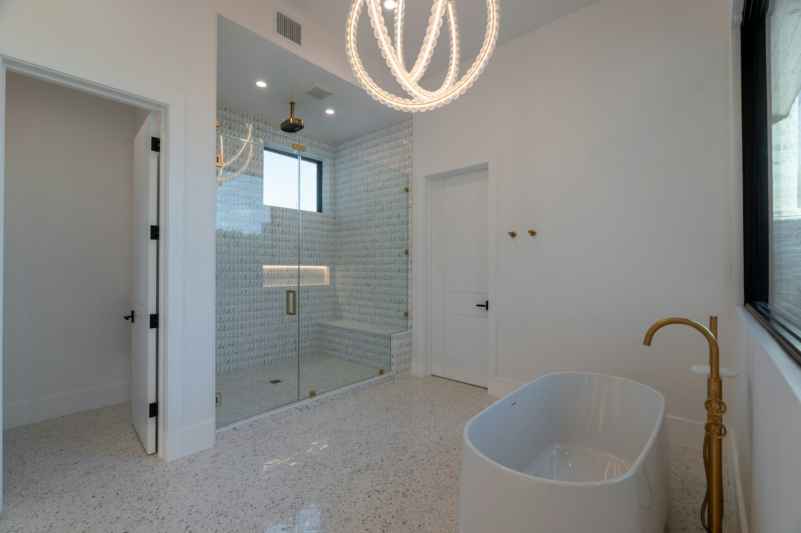

Most people want to stay in their home as they get older. The renovations that make that possible are far cheaper to build in now, while walls are already open, than to retrofit in a hurry later. Done well, they don’t look clinical; they just make the house easier to live in for everyone.

## Start with the main floor

The single most useful change is a bedroom and a full bathroom on the main floor. In many GTA houses that means converting a den, dining room or family room, or adding a small rear addition. Once the main floor can work on its own, the stairs become optional rather than a daily necessity.

## Bathrooms

- **A curbless shower** with a linear drain, so there’s no step to catch a foot or a walker.
- **A built-in bench** and a handheld shower on a slide bar.
- **Blocking in the walls** for grab bars, even if the bars go in later. It costs very little during framing and a lot afterward.
- **A comfort-height toilet** and a vanity with knee space or open storage.
- **Slip-resistant tile**, usually a matte finish, on the floor and in the shower.
- **Lever handles** and a pressure-balancing or thermostatic valve to prevent scalding.

## Doors, halls and floors

Wider doorways, in the range of 34 to 36 inches, make room for a walker or wheelchair and make moving furniture easier for everyone. Lever handles replace knobs. Thresholds go flush, and small level changes between rooms come out. Lighting matters more than people expect: switches at every entrance, brighter halls and low night lighting on the way to the bathroom.

## Stairs and entrances

Handrails on both sides of every stair, with a contrasting edge on each step, prevent most falls. If a stairlift may be needed someday, a straight stair with a nearby outlet makes it a simple installation. At the front door, a covered entry with no steps, or a gentle ramp where the grade allows, makes coming home easier with groceries, strollers or mobility aids.

## Kitchens

- **Drawers instead of lower cabinets**, so nothing is hidden at the back of a deep shelf.
- **A wall oven** at a comfortable height, and a microwave below the counter rather than above the range.
- **An induction cooktop**, with no open flame and automatic shut-off.
- **Counters at more than one height** where space allows.

## Tax credits

The federal Home Accessibility Tax Credit can apply to renovations that make a home safer or more accessible for a person who is 65 or older, or who is eligible for the disability tax credit. If a parent is moving in, the Multigenerational Home Renovation Tax Credit may also apply. Annual limits and rules change, so confirm eligibility with the CRA or an accountant. Our guide to [renovation rebates and tax credits](/journal/ontario-home-renovation-rebates) covers both.

## Planning it well

The best aging-in-place renovations are planned as part of a larger project: a [bathroom renovation](/services/bathroom-renovations), a [whole-home renovation](/services/home-renovations) or an [addition](/services/home-additions) that brings a bedroom to the main floor. If three generations will share the house, see our guide to [designing a multigenerational home](/journal/multigenerational-home-design-gta). To talk through your house, [book a consultation](/contact).
