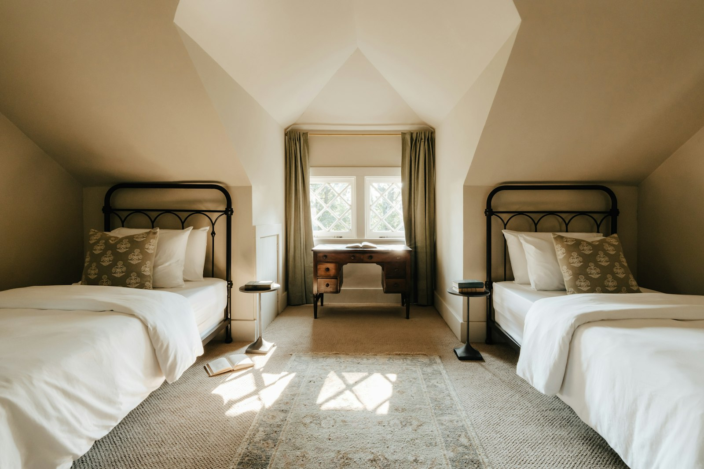

Many older Toronto houses, especially those built before 1950 with steep roofs, have an attic large enough to become a bedroom, an office or a primary suite. It’s a way to add space without touching the footprint of the house. Whether it works depends on height, structure and stairs.

## Is your attic a candidate?

**Headroom.** The building code sets minimum ceiling heights for living spaces over a minimum part of the floor, and areas with very low headroom don’t count toward the room’s required area. In practice, you want around 2.1 to 2.3 m of height over at least half of the room. Measure from the floor joists to the underside of the ridge, then subtract the new floor, insulation and finishes.

**Roof pitch.** Steep roofs leave usable height across more of the floor. Shallow roofs often need a dormer, or aren’t practical at all.

**Framing.** Many attics are framed with roof trusses, the triangulated webs common in houses from the 1970s on. Trusses can’t simply be cut out; converting a trussed attic is usually a structural rebuild. Older houses with rafters and ceiling joists are better candidates.

**The floor.** Ceiling joists below the attic were often sized only to hold up a ceiling. They usually need reinforcing to carry a room.

## Dormers

A dormer extends part of the roof outward to add headroom and a window.

- **Shed dormers** add the most usable space and are common on the rear of Toronto houses.
- **Gable dormers** are smaller and suit the front of traditional houses better.

A dormer is structural work and adds cost, but it often turns a marginal attic into a real room. In heritage districts, front-facing dormers may need heritage approval.

## Stairs

A ladder or hatch won’t do for a habitable room. You need a code-compliant stair, which takes floor area on the level below, often from a bedroom or closet. Where the stair goes is frequently the hardest design question in an attic conversion.

## Insulation and comfort

Attics are hot in summer and cold in winter. The roof assembly needs to be insulated and ventilated correctly, often with spray foam or a combination of rigid and batt insulation. A ductless heat pump is usually the simplest way to heat and cool the new room.

## Egress and fire safety

A bedroom needs a window large enough to escape through, and smoke alarms connected to the rest of the house.

## What it costs

| Scope | Typical cost |
| --- | --- |
| Finishing an attic with good existing height | $60,000–$110,000 |
| Adding a dormer | add $35,000–$70,000 |
| Full conversion with dormer and bathroom | $120,000–$200,000 |

All attic conversions need a building permit and structural drawings.

If the attic doesn’t work, compare a [second-storey or rear addition](/journal/second-story-vs-rear-addition-gta).
