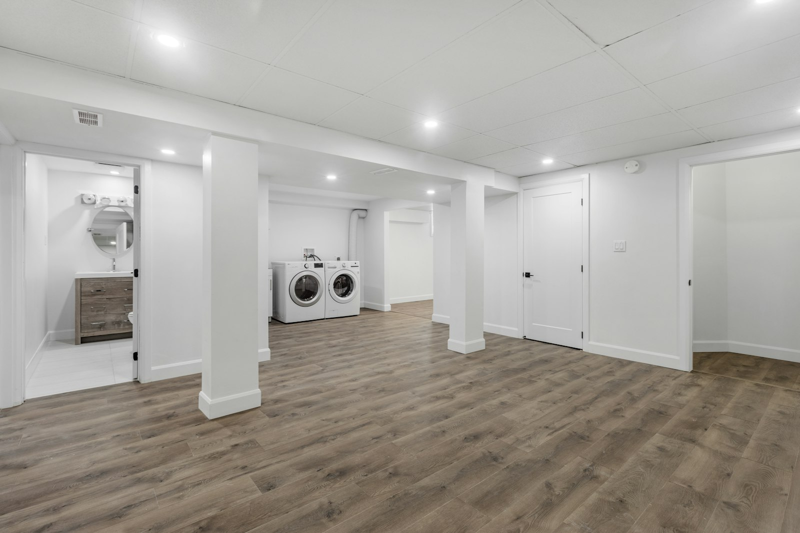
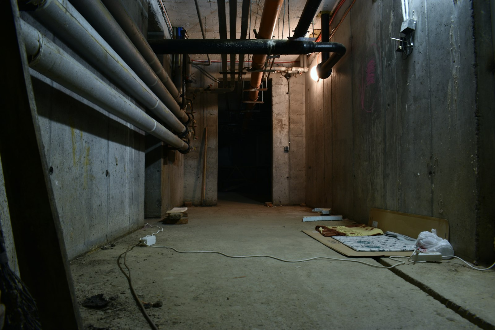

Finishing a dry, reasonably tall basement in the GTA typically costs **$70 to $110 per square foot**. A legal second unit, with a kitchen, a bathroom, egress windows, fire separation and a separate entrance, usually costs **$120,000 to $200,000** for a typical detached house. Underpinning to gain ceiling height is a separate project and often the biggest number on the page.

## What you’re paying for

| Scope | Typical cost | Includes |
| --- | --- | --- |
| Finished basement | $70–$110 per sq ft | Insulation, framing, drywall, flooring, lighting, a bathroom, trim and paint. |
| Legal second unit | $120,000–$200,000 | All of the above, plus a kitchen, separate entrance, egress windows, fire separation, interconnected alarms and a permit. |
| Underpinning | $80,000–$150,000+ | Lowering the floor by deepening the footings, for a full basement in a typical detached house. |

## Start with water

Every basement plan starts with the same question: where does water get in, or where could it? Look for efflorescence (the white crust on foundation walls), staining at the base of walls, a musty smell, and how the yard grades around the house. Most basement leaks in the GTA come from the outside: downspouts that drain at the foundation, flat or reversed grading, and window wells without drains.

Fix those first. Then insulate the foundation walls with materials that tolerate occasional moisture, and keep wood framing off the concrete. Finishing over a moisture problem only hides it until it ruins the drywall and flooring.

## A basement or a suite?

A finished basement adds living space. A legal second unit adds a home. Since Ontario’s 2022 housing changes, most detached houses, semi-detached houses and townhouses in urban areas can have up to three residential units, and those additional units are exempt from development charges. That has made the legal basement suite one of the most practical renovations in the GTA, whether it’s rented or used by family.

The extra cost of a suite over a finished basement comes from a handful of requirements:

- **Egress windows** in every bedroom, large enough to climb out of, with a window well that leaves room in front of the window.
- **A rated fire separation** between the units, usually built with fire-rated drywall and sealed penetrations. The required rating depends on the age of the house and its other safety features.
- **Interconnected smoke and carbon monoxide alarms** in both units.
- **A separate entrance**, often a side-yard walk-down with a new door cut into the foundation.
- **Separate or properly separated heating**, so smoke can’t travel between units through the ductwork.
- **A kitchen** with its own electrical circuits and ventilation.

Our guide to [legalizing a secondary suite](/journal/toronto-secondary-suite-legalization-guide) covers each requirement in more detail.

## Ceiling height

For a second unit in an existing house, the building code’s compliance alternatives generally allow about 1.95 m of clear height under beams and ducts. Many older Toronto basements are lower than that. The options are to reroute ducts, lower the floor by underpinning, or build bench footings. See [underpinning versus bench footings](/journal/basement-underpinning-vs-bench-footing).

## Does a suite pay for itself?

It depends on what you spend and what the unit rents for in your neighbourhood. A simple way to frame it: divide the all-in cost by the annual rent after expenses. A $160,000 suite that nets $20,000 a year pays back in eight years, and adds value to the house in the meantime. A suite that needs $100,000 of underpinning first takes much longer.

For many families the decision isn’t about rent at all. A legal suite is a home for a parent, an adult child, or a caregiver, built to the same safety standard as the rest of the house. Our [multigenerational home guide](/journal/multigenerational-home-design-gta) covers that use.

## Timeline

Plan on three to six weeks for design and drawings, four to ten weeks for the permit, and eight to fourteen weeks of construction for a suite. A finished basement without a second unit is usually faster, especially if no permit-heavy work is involved.
