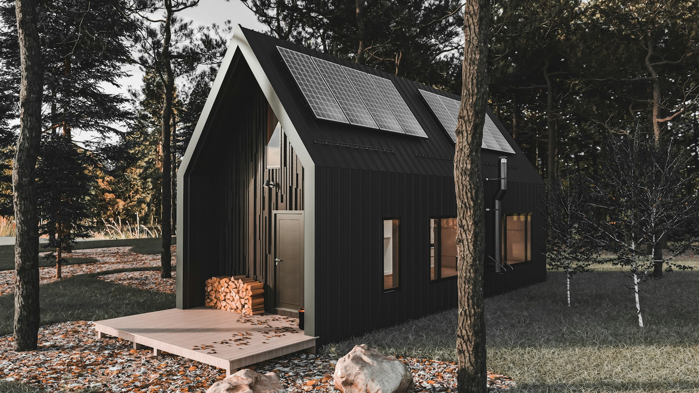

Toronto homeowners who want a second home on their lot, for rent or for family, usually choose between a unit in the basement and a separate suite in the backyard. Both are legal on most lots. They’re very different projects.

## Side by side

| | Basement suite | Laneway or garden suite |
| --- | --- | --- |
| Typical cost | $120,000–$200,000 | $350,000–$600,000 |
| Timeline | 4–7 months | 10–18 months |
| Light and privacy | Limited | Excellent |
| Accessibility | Usually stairs | Can be fully level |
| Lot requirement | A suitable basement | A lane, or enough rear yard, plus fire access |
| Disruption to the main house | Significant during construction | Mostly in the yard |
| Development charges | Exempt | Exempt |

## The basement suite

A basement suite uses space you already have, so it costs far less. It’s the fastest route to rental income and the more common choice.

The limits are physical. Ceiling height, window size and the depth of the basement decide how pleasant it is. Low basements may need underpinning, which can add $80,000 or more. Read [underpinning or bench footing](/journal/basement-underpinning-vs-bench-footing).

## The laneway or garden suite

A backyard suite is a small detached house: windows on four sides, its own entrance, and no shared walls or ceilings. It suits family members who want independence, people who can’t manage stairs, and owners who want a higher-quality rental.

It costs more because it’s a whole building, and it’s limited by the lot: a lane or enough rear yard, a fire access route, servicing and trees. Read [what a laneway or garden suite costs](/journal/laneway-suite-cost-toronto).

## How to decide

- **Lowest cost and fastest income:** a basement suite.
- **A parent who shouldn’t use stairs:** a backyard suite with a level entry.
- **Maximum privacy for both households:** a backyard suite.
- **A low, wet basement:** price the waterproofing and underpinning before assuming the basement is cheaper.
- **Both?** Ontario’s rules allow up to three units on most lots, so some owners build a basement unit now and a garden suite later.

We can assess both options on a single site visit. See [adding a second or third unit](/journal/additional-residential-units-york-region) for the rules outside Toronto.
