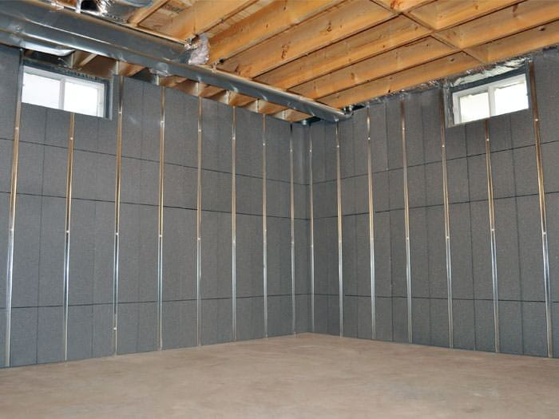

Many GTA basements, especially in houses built before the 1960s, are too low to be comfortable living space, and too low for a legal second unit. If the ceiling can’t go up, the floor has to come down. There are two ways to do it.

## The problem

Ceiling height in a basement is measured to the lowest obstruction, usually a beam or a duct. Many older Toronto basements have six feet or less under the beams. For a second unit in an existing house, the code’s compliance alternatives generally allow about 1.95 m clear under beams and ducts; for comfortable living space, most people want well over two metres.

Before lowering anything, check what can be moved: ducts can sometimes be rerouted between joists, and a dropped beam can sometimes be replaced with a flush one. That can gain a few inches for much less money.

## Underpinning

Underpinning extends the existing foundation walls downward. The work is done in short sections so the house is supported at all times: a section of soil under the footing is excavated, a new deeper footing and wall section are poured beneath the old one, and once it cures, the next section is done. After the perimeter is complete, the floor is excavated, new drainage and a new slab go in.

**Pros:** you keep the full floor area, and walls go straight down. It’s the best result for a finished basement or a second unit.

**Cons:** it’s engineered structural work with permit drawings and inspections, it takes several weeks, and it’s the most expensive option.

## Bench footing

A bench footing leaves the existing footings in place and lowers the floor inside them, building a concrete “bench” around the perimeter to protect the soil supporting the old footing.

**Pros:** less excavation under the house, faster, and typically 30 to 50 percent less expensive than underpinning.

**Cons:** the bench takes floor space around the edges, often 12 to 24 inches deep, and it shows. It can be built into seating or storage, but it’s always there.

## Costs

For a full basement in a typical detached house, underpinning often runs **$80,000 to $150,000** or more, depending on depth, soil, access and the number of walls. A bench footing for the same basement usually comes in well below that. Both need an engineer and a building permit, and both usually include new drainage and a new slab.

## How to choose

- **Building a legal second unit, or want a full-size room?** Underpinning.
- **Want a rec room or gym, and can live with a ledge?** Bench footing.
- **Close to the height you need already?** Look at ducts and beams first.

Whichever you choose, deal with water at the same time. A lowered floor is an opportunity to install proper drainage and a sump. Read [what finishing a basement costs](/journal/basement-renovation-cost-gta) for the rest of the budget.
