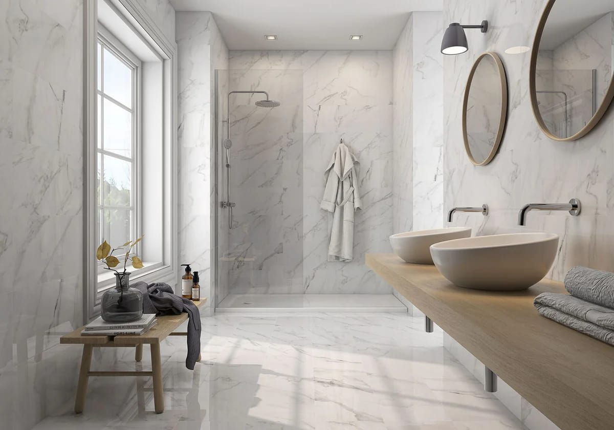

A full renovation of a standard GTA bathroom usually costs **$25,000 to $45,000**. A primary ensuite with a larger walk-in shower, a freestanding tub, heated floors and a custom vanity usually lands between **$45,000 and $90,000**. A powder room can be done for $12,000 to $25,000. All figures are before HST.

Bathrooms cost more per square foot than any other room in the house, because a small space holds plumbing, electrical, ventilation, waterproofing, tile and cabinetry, each done by a different trade.

## Three kinds of bathroom

| Bathroom | Typical cost | What usually changes |
| --- | --- | --- |
| Powder room | $12,000–$25,000 | Vanity, toilet, flooring, lighting, mirror, paint. Rarely any plumbing moves. |
| Main or family bathroom | $25,000–$45,000 | Full gut: tub or shower, waterproofing, tile, vanity, toilet, fan, lighting. |
| Primary ensuite | $45,000–$90,000 | Larger walk-in or curbless shower, double vanity, heated floor, sometimes a freestanding tub and a layout change. |

## The parts you never see

The difference between a bathroom that lasts twenty years and one that leaks in five is almost entirely hidden.

**Waterproofing.** Tile and grout aren’t waterproof. Water passes through them, and what stops it reaching the wall framing is a membrane underneath, either a bonded sheet or a liquid-applied coating. In a good installation the membrane covers the whole shower, laps over the tub or shower base, and is flood-tested before tile goes on.

**Slope and drains.** A shower floor needs a consistent slope to the drain. Linear drains make curbless showers easier to slope because the floor only has to fall in one direction.

**Ventilation.** An exhaust fan sized to the room and ducted outside, not into the attic, is what prevents mould on the ceiling and peeling paint. A fan on a humidity sensor or timer keeps running after the shower is off.

**Blocking.** Wood blocking inside the walls costs almost nothing during a renovation and lets you add grab bars, a heavy mirror or a wall-hung vanity later without opening the wall.

## What pushes the price up

- **Moving the toilet.** It has the largest drain in the room. Moving it can mean opening the ceiling below or cutting a slab, and is the biggest single cost driver in a layout change.
- **Converting a tub to a curbless shower.** The floor framing may need to be lowered or reworked to get the slope without a step.
- **Large-format or natural stone tile.** Bigger tiles need a flatter substrate and more careful setting. Marble needs sealing.
- **Frameless glass.** Thick glass panels are made to measure after tile is finished, which adds cost and a week or two.
- **Steam showers.** They need a vapour-tight enclosure, a generator and dedicated electrical. We rarely recommend them.

## Where you can save

- Keep the toilet and drain where they are.
- Use one large-format porcelain tile on the floor and a simpler, less expensive tile on the walls outside the shower.
- Choose a good-quality stock vanity and put the budget into the shower.
- Skip the tub in the ensuite if there’s another tub in the house.

## How long it takes

Plan for two to four weeks to choose fixtures and finishes, two to four weeks for orders to arrive, and three to five weeks on site. Glass is measured after the tile is done, so the last few days of a bathroom are often a short wait for the shower door.

## Does a bathroom need a permit?

Replacing fixtures in the same place generally doesn’t. Adding a new bathroom, moving drains or vents, or changing walls generally does. See our guide to [when you need a building permit in Ontario](/journal/do-i-need-a-building-permit-ontario).

If you’re deciding what to include in an ensuite, our guide to [primary bathroom features worth the money](/journal/master-bathroom-renovation-features-gta) goes through what holds value and what doesn’t.
