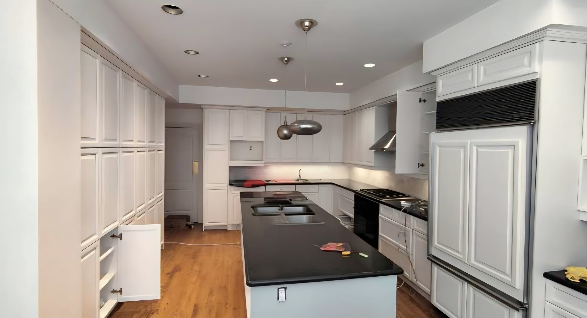

The layout of a kitchen matters more than anything you put in it. A beautiful kitchen with a bad layout is frustrating every day; a simple kitchen with a good one is a pleasure. And layout decisions are free on paper and expensive once plumbing and cabinets are in.

## Start with clearances

These numbers decide whether a layout works:

| Space | Comfortable minimum |
| --- | --- |
| Work aisle, one cook | about 42 in (1.07 m) |
| Work aisle, two cooks | about 48 in (1.22 m) |
| Walkway behind seated stools | about 36–44 in |
| Counter on each side of the cooktop | 12–15 in or more |
| Landing space next to the fridge | about 15 in |

If your room can’t fit an island with these clearances, it’s better without one.

## The common layouts

**Galley.** Two parallel runs. Very efficient for one cook and common in condos and narrow Toronto semis. With two cooks it becomes a corridor.

**L-shape.** Two adjacent walls, leaving the room open on two sides. Flexible, works in many 1980s and 1990s GTA houses, and leaves room for a table or island.

**U-shape.** Three walls of cabinets. The most storage and counter space, best in a separate kitchen room at least about 10 feet wide.

**Island.** An L or U with a freestanding island. The GTA favourite, because it adds seating and storage and anchors an open plan. It needs the clearances above on every working side.

**Peninsula.** A counter run attached at one end. Gives most of the benefits of an island where the room is too narrow for one. Our [condo kitchen](/projects/apartment-kitchen-renovation) uses a waterfall peninsula for exactly that reason.

## Plan zones, not a triangle

The classic work triangle between sink, cooktop and fridge still helps, but most families now plan by zones:

- **Storage:** fridge and pantry together, near where groceries come in
- **Prep:** the longest clear counter, ideally between sink and cooktop
- **Cooking:** cooktop or range, with landing space on both sides and the hood above
- **Cleaning:** sink, dishwasher and garbage together, near the dish storage

Keep through-traffic, especially to the back door or the family room, out of the cooking zone.

## Heavy cooking changes the plan

Families who cook with high heat should plan ventilation before the layout. A cooktop on an outside wall makes a straight, short duct possible; a cooktop on an island makes capture and ducting harder. Some families add a separate [wok kitchen](/journal/wok-kitchen-ventilation) and keep the main kitchen for lighter cooking.

## What moving things costs

- Relocating the sink: a new drain and vent, often $3,000 to $8,000
- Relocating a gas range: a new gas line, often $2,000 to $5,000
- Removing a wall to open the kitchen: see [removing a load-bearing wall](/journal/removing-a-load-bearing-wall)

For the full budget picture, read [what a kitchen renovation costs](/journal/kitchen-renovation-cost-gta).
