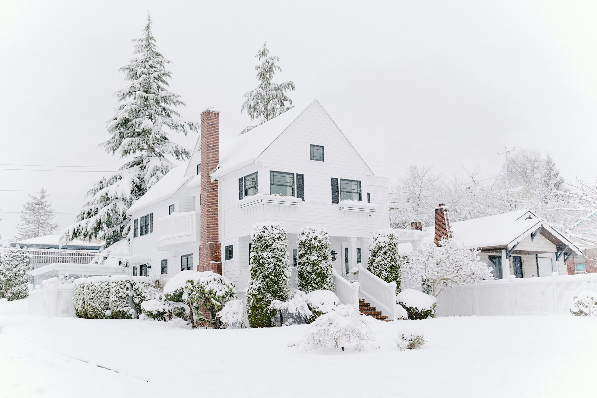

Construction in the GTA doesn’t stop in November. Some work slows down or costs more in the cold, and some is better done in winter than any other time. Knowing which is which lets you plan a project so the weather works for you rather than against you.

## What works well in winter

- **Interior renovations.** Kitchens, bathrooms, basements and whole-home interiors carry on as normal once the house is heated.
- **Framing**, with snow cleared from decks and lumber kept covered.
- **Design and permits.** Winter is the best time to finish drawings and get permits in hand, so construction can start as soon as the ground thaws.

## What takes extra care

- **Concrete.** Footings can’t be poured on frozen ground. In cold weather, excavations are protected and concrete is kept warm with insulated blankets or heated enclosures while it cures, following the cold-weather requirements of CSA A23.1.
- **Excavation.** Frozen ground is slower and costlier to dig.
- **Masonry and stucco.** Mortar and stucco need protection from freezing while they cure, which usually means heated enclosures.
- **Paint, sealants and exterior finishes.** Most have minimum application temperatures and wait for milder days.
- **Roofing.** Shingles can go on in the cold, but their sealing strips may not bond until warmer weather, so installers hand-seal them in winter.

## Additions and roof-off work

A second-storey addition means opening the roof, and that’s the stage to schedule for spring or summer. A rear addition can be framed and closed in through the fall, then finished inside over the winter. We plan the sequence so the house is weathertight before the first heavy snow.

## Cost and schedule

Winter work carries extra costs: temporary heat, enclosures and hoarding, snow clearing, and shorter days. Weather delays are also more likely, so a realistic winter schedule includes buffer days. For interior work, these costs are small. For foundations and exterior work, they can be significant, which is why we often recommend designing and permitting in winter and breaking ground in spring.

## Living in the house during winter work

If you’re staying in the house, heating matters. Open walls and exterior work mean colder rooms and more dust. We seal off work areas, keep the heat running in the occupied part of the house, and plan any utility shut-offs for the warmest part of the day.

## A sensible year

For most larger projects in the GTA, a good rhythm looks like this:

1. **Fall and winter:** design, engineering and permit applications.
2. **Spring:** break ground once frost is out of the ground.
3. **Summer:** structure, roofing and exterior work.
4. **Fall:** close in before the snow, then finish inside through the winter.

If you’re planning a [custom home](/services/custom-homes) or an [addition](/services/home-additions), now is the right time to start the design. See [how long an addition takes](/journal/how-long-does-home-addition-take-toronto), or [book a consultation](/contact) to plan your schedule.
