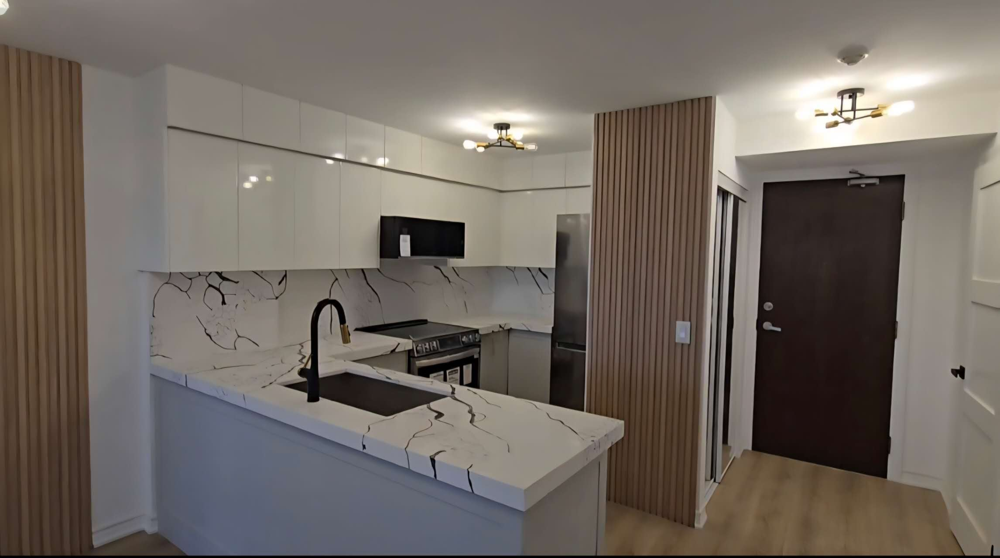
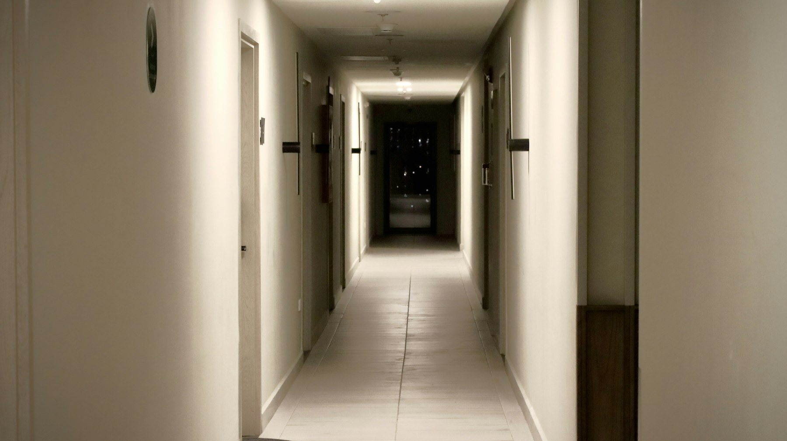

A condo renovation uses the same trades as any other, but the building is shared, so the rules are different. Most of the planning happens before anyone picks up a tool: getting approval from the condominium corporation, understanding what you own, and fitting the work around the building’s schedule.

## Read the declaration and rules first

Every condominium in Ontario has a declaration, by-laws and rules. Together they set out where your unit ends and the common elements begin, and what you need before starting work. Most corporations require an alteration request, reviewed by management or the board, before any renovation beyond paint.

A typical approval package includes:

- **Drawings or a written scope** of what’s changing.
- **Proof of the contractor’s liability insurance**, often naming the corporation.
- **A WSIB clearance certificate.**
- **A schedule**, with working days and when water shut-offs are needed.
- **A deposit** against damage to common areas, in some buildings.

Changes that touch the common elements, such as anything in a slab, a shared wall or the building’s systems, usually need a written agreement with the corporation under section 98 of the Condominium Act.

## What usually can’t move

- **Plumbing stacks** run through every floor and stay where they are. Sinks and toilets can only move as far as a drain can slope back to them.
- **Concrete walls and columns** are structural.
- **Windows and exterior doors** are usually common elements.
- **Fire-rated suite doors and fire separations** have to stay rated.
- **Coring the slab** needs engineering, a scan for cables and tendons, and the corporation’s approval.

## Flooring and sound

Replacing carpet with hardwood, vinyl or tile is the change most likely to need specific approval. Many buildings set a minimum sound rating for the underlay under hard flooring, to protect the unit below. Get the requirement in writing before choosing flooring; some products can’t meet it.

## Working hours, elevators and deliveries

Condo work runs on the building’s schedule. Expect restricted working hours, often weekdays only, a booked service elevator with protective pads, and rules for debris removal and trade parking. Water shut-offs are arranged through management with notice to neighbours. A good contractor plans the whole schedule around these from day one, so the job doesn’t stall halfway.

## Permits

Condo approval is separate from a building permit. Cosmetic work usually doesn’t need a permit, but new plumbing fixtures, relocated drains, structural changes and changes to fire separations do. We confirm which applies before the approval package goes in, so both run in parallel.

## How long it takes

Approval can take a few weeks, so it belongs at the start of the schedule, alongside ordering long-lead items like cabinets. Our [Burlington condo kitchen and bathroom](/projects/apartment-kitchen-renovation) took six weeks on site once approvals were in place.

## How we handle it

We prepare the approval package, including drawings, insurance and WSIB certificates and the schedule, and coordinate directly with property management through the project. If you’re planning a condo [kitchen](/services/kitchen-renovations) or [bathroom](/services/bathroom-renovations), [send us the details](/contact) and we’ll tell you what your building is likely to ask for.
