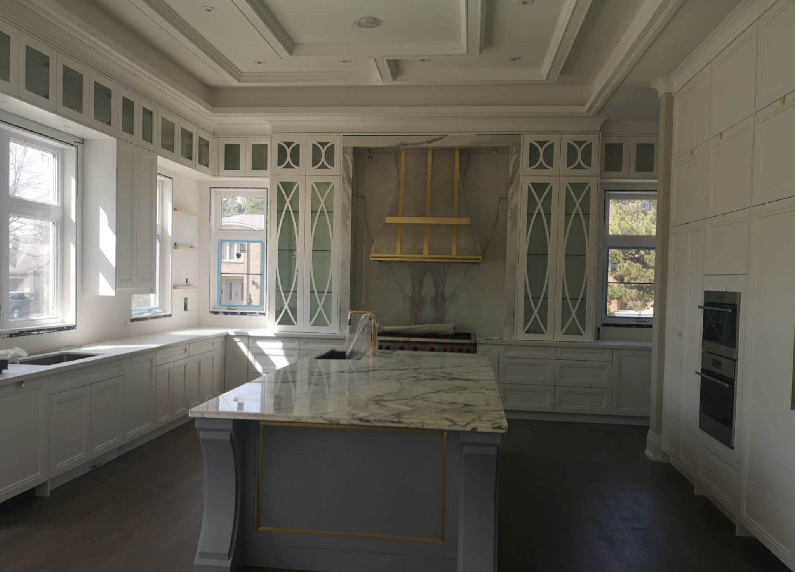
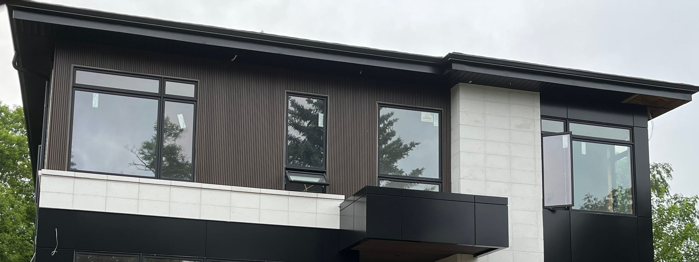

Most custom homes we price in the GTA cost **$400 to $700 per square foot** of finished floor area to build, not including land. Homes with full stone facades, extensive custom millwork, large structural spans, or high-end mechanical systems sit above that range. A 3,500 sq ft house at $550 per sq ft is roughly $1.9 million in construction.

That figure is only part of the budget. The rest is a list of costs that depend on your lot and your decisions, and they’re where custom home budgets most often go wrong.

## What sits outside the construction number

- **Demolition.** Taking down an existing house, removing the foundation and disconnecting services: commonly $30,000 to $60,000, more if there’s asbestos to remove first.
- **Design and engineering.** Architectural, structural and mechanical drawings, a survey, and sometimes a geotechnical report and an arborist report.
- **Permits and fees.** Building and demolition permits, tree permits, and service connection fees. If you’re replacing an existing house, development charges for the new house are generally credited against the one being demolished.
- **Site servicing.** New water and sewer connections, hydro and gas, which vary with how far the services are from the house.
- **Landscaping, driveway and fencing.**
- **Furnishings and appliances**, if they aren’t in the construction contract.
- **HST.** A new home is taxable. Depending on your situation, new-home rebates may apply; ask your accountant early.

## What drives the per-square-foot cost

**The envelope.** Stone costs more than stucco, which costs more than siding. Large window walls cost more than punched windows, and the triple-glazed units that make them comfortable cost more again.

**The structure.** Open plans with long spans need steel or engineered beams. Vaulted and coffered ceilings add framing and finishing time. Our Vaughan custom home has coffered ceilings in several rooms, and they’re a visible part of what made it expensive to build well.

**The basement.** A walk-out, a deep basement or a high water table adds excavation, waterproofing and sometimes engineered shoring.

**Interior detail.** Custom millwork, stone fireplace walls and slab backsplashes take more time than any other finish, from shop drawings to installation.

**Mechanical systems.** Heated floors, heat pumps, multi-zone HVAC and whole-home automation all add cost and coordination.

## A realistic schedule

| Phase | Typical duration |
| --- | --- |
| Feasibility and design | 10–20 weeks |
| Permits and approvals | 8–20 weeks, longer with a variance |
| Construction | 10–14 months |

The permit phase is the hardest to predict. A design that fits within the zoning by-law moves through a standard review. A design that needs a minor variance goes to the Committee of Adjustment, which usually adds three to six months.

## How to keep the budget honest

- **Check feasibility before you pay for full drawings.** Zoning, trees, grading and services decide what can be built.
- **Ask for allowances in writing.** If a quote includes $40,000 for kitchen cabinetry and you want $90,000 cabinetry, that difference should be visible in the quote, not discovered later.
- **Carry a contingency.** Five to ten percent for a new house on a known lot, more if the existing house or site has surprises.
- **Make decisions on schedule.** Late selections are one of the most common reasons custom homes run over time.

New homes in Ontario carry a statutory warranty, and the builder must be licensed. Our guide to [HCRA and Tarion](/journal/hcra-vs-tarion-ontario-homeowner-guide) explains how that protects you. If you’re still deciding whether to build new at all, read [renovate, add on, or rebuild?](/journal/renovate-add-or-rebuild).
