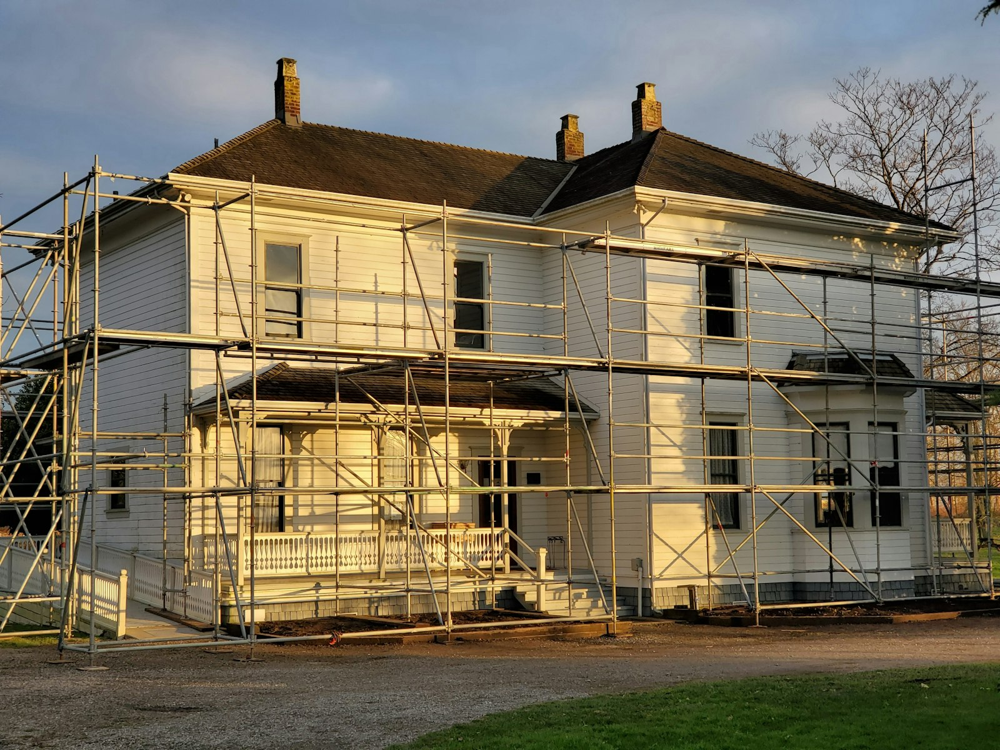

In Ontario, the Building Code Act requires a building permit before you construct, renovate, demolish or change the use of a building, with some exceptions for minor work. Your municipality issues the permit: Toronto Building, or the building department in Markham, Richmond Hill or Vaughan.

The rule of thumb: if the work changes structure, plumbing, heating and ventilation, fire safety, or how a space is used, you need a permit. If it’s cosmetic, you usually don’t.

## Usually needs a permit

- Removing or altering a load-bearing wall, or adding a beam
- Additions, second storeys, porches and garages
- Finishing a basement with new walls, or adding a bathroom
- Creating a second unit, a basement apartment or a garden suite
- Moving or adding plumbing fixtures, drains or vents
- New or relocated heating, ventilation and air conditioning, including most new ductwork
- New fireplaces and wood stoves
- Enlarging a window or door opening, or cutting a new one in an exterior wall or foundation
- Decks more than 60 cm above the ground (some municipalities also require one for any deck attached to the house)
- Underpinning or lowering a basement
- Demolishing a building

## Usually doesn’t need a permit

- Painting, flooring, trim and drywall repairs
- Replacing kitchen cabinets and counters in the same layout
- Replacing plumbing fixtures in the same location
- Replacing windows and doors in the same size opening
- Re-shingling a roof without structural changes
- Small sheds below the size limit set by the code and your municipality
- Fences, though they may be governed by a separate fence by-law

When in doubt, ask the building department or your contractor before work starts. It costs nothing to ask.

## Electrical work is separate

Electrical work in Ontario is regulated by the Electrical Safety Authority, not the building department. A licensed electrical contractor files a notification with ESA and the work is inspected by ESA. This applies even when no building permit is needed.

## How long it takes

Ontario sets maximum review times for complete applications. In practice, timing depends on the municipality, the season and how complete the drawings are:

- Simple interior alterations: a few weeks
- Houses and additions that meet zoning: roughly 6 to 12 weeks
- Projects that need a minor variance first: add three to six months for the Committee of Adjustment

Incomplete applications are the most common cause of delay. Each round of plans examiner comments adds time.

## Other approvals that can come first

- **Zoning.** The design must meet the zoning by-law, or get a variance.
- **Trees.** Protected trees need a separate permit. See [tree permits before you build](/journal/tree-permits-before-you-build).
- **Heritage.** Properties in heritage conservation districts need heritage approval for exterior work.
- **Conservation authority.** Lots near ravines, rivers and wetlands may need a permit from the Toronto and Region Conservation Authority.

## What happens if you skip it

Unpermitted work can surface in a home inspection when you sell, in an insurance claim, or when a neighbour complains. The municipality can issue an order to stop work, open walls for inspection, or remove the work. Legalizing it later almost always costs more than permitting it the first time.

## Who should apply

On our projects, we prepare and submit the permit application, respond to plans examiner comments and book the inspections. If a contractor suggests skipping a permit to save time or money, treat it as a warning.
