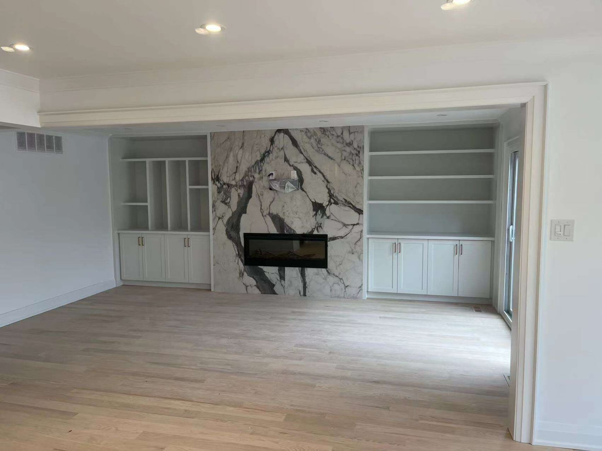

Many of our clients care about feng shui. Some follow it closely and bring a consultant; others simply prefer that the front door not line up with the back door. Either way, the most useful thing we can say as builders is this: **almost every feng shui preference is cheap to accommodate on paper and expensive to change after construction.** Raise them at the first design meeting.

This isn’t a guide to feng shui itself. It’s a guide to the preferences we’re asked about most, and what they mean for a floor plan.

## The entrance

Many families want an entrance that’s open, bright and uncluttered, and a front door that doesn’t look straight through the house to a back door or large rear window.

In design terms, this is also good practice: a proper foyer with closet storage, a view that turns rather than tunnels, and natural light at the entry. In an open-concept renovation, a partial wall, a built-in or a change in ceiling height can stop the straight line from front to back without closing the plan.

**When to decide:** before the layout is fixed. Moving a door or a stair later is expensive.

## The stairs

A common preference is that the staircase not face the front door directly. In a new custom home, the stair can be turned or placed to the side of the foyer at no extra cost. In a renovation, moving a stair is major structural work, so it’s usually addressed with the landing, a screen or the entry layout instead.

## The kitchen

Two preferences come up often: the cooktop shouldn’t face the sink directly across a narrow aisle, and the cook should be able to see the room, ideally the doorway, while cooking.

Both overlap with good kitchen design. Separating the hot and wet zones gives two people room to work, and a cooktop on an island or a wall facing into the room keeps the cook part of the household. See [kitchen layouts for GTA homes](/journal/best-kitchen-layouts-gta-homes).

## The bedroom

The usual requests: the bed should have a solid wall behind it, not sit under a window, and have a view of the door without being in line with it. Avoid placing it under an exposed beam or a sloped ceiling.

These affect where we put windows, doors and closets in a new home or an addition, and where the electrical boxes for bedside lights go. All are easy to plan and annoying to move.

## Light, air and clutter

Natural light, fresh air and plenty of storage appear in almost every feng shui tradition, and in every good house. Larger windows where the zoning and energy code allow, good ventilation, and built-in storage so surfaces stay clear are worth planning regardless.

## Numbers, colours and dates

Some families prefer to avoid the number four and favour eight, or want work to start on an auspicious date. The address is set by the municipality and rarely changes, but unit numbers in a multi-unit house, the colour palette and the start date are all easy to accommodate if we know early.

## How we handle it

Tell us at the first meeting what matters to your family, or invite your consultant to a design review. We’ll mark the preferences on the plan alongside the zoning and structural constraints, show you where they conflict, and suggest options. It costs nothing at that stage. After the foundation is poured, it can cost a great deal.
