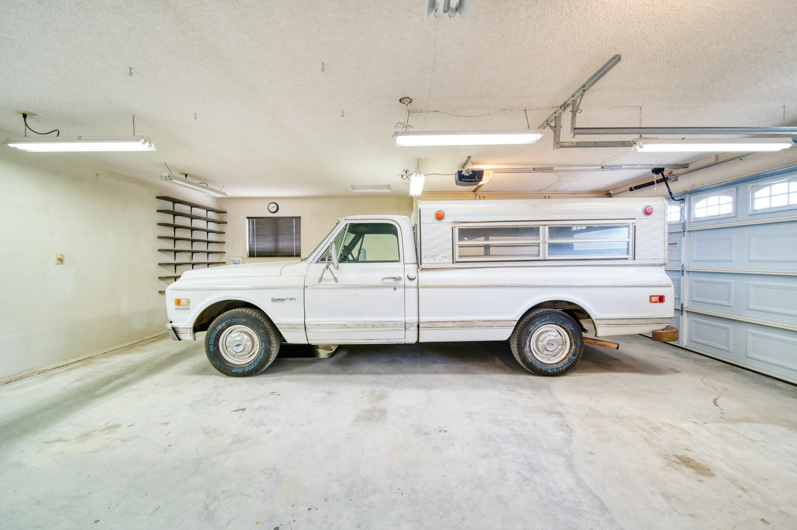

A garage already has a foundation, walls and a roof, which makes it one of the least expensive places to add living space. Turning it into a room people want to spend time in takes more than drywall, though.

## What changes

A garage is built to be cold and to keep car fumes and fire away from the house. To make it a habitable room:

- **The floor.** Garage slabs are usually thin, uninsulated and sloped toward the door. They need insulation and a new level subfloor, which raises the floor height.
- **The walls and ceiling.** Insulated to current standards and finished.
- **The door opening.** The overhead door is replaced with a wall, often with a window, built on a proper footing or curb.
- **Heating and cooling.** A ductless heat pump is often the simplest option; extending existing ductwork may also work.
- **Electrical.** Outlets, lighting and smoke alarms to code.
- **Ventilation and moisture control.**

## Permits and zoning

Converting a garage to living space is a change of use and needs a building permit in every GTA municipality.

Zoning is the other question. Many zoning by-laws require one or more parking spaces on the lot. If the garage provides the required parking, converting it can require a minor variance unless the driveway provides it. Check before designing.

## Garage to legal unit

A garage, especially a detached one at the back of the lot, can become a legal additional unit under Ontario’s 2022 rules. That adds the requirements of a separate dwelling: water and sewer service, fire separation and egress where it shares a wall with the house, and its own heating. See [adding a second or third unit](/journal/additional-residential-units-york-region).

## What it costs

| Conversion | Typical cost |
| --- | --- |
| Office, gym or playroom | $40,000–$80,000 |
| Bedroom with a bathroom | $70,000–$120,000 |
| Legal self-contained unit | $100,000–$180,000 |

Adding plumbing is the biggest variable. If drains have to be cut into the slab and run to the main stack, the cost climbs.

## Is it the right move?

A garage conversion is a good fit when you need one or two rooms and can give up the parking. If you need more space than that, or want to keep the garage, look at [second-storey or rear additions](/journal/second-story-vs-rear-addition-gta), or an [attic conversion](/journal/attic-conversion-toronto-homes) if the roof allows it.
