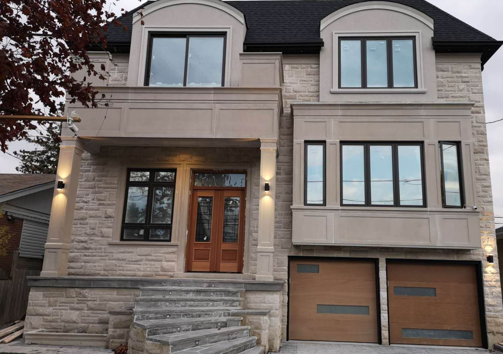

If you’re building a new home in Ontario, two organizations protect you: the Home Construction Regulatory Authority (HCRA) and Tarion. They’re often confused, and neither covers renovations. Here is what each one does.

## HCRA licenses the builder

The HCRA is the provincial regulator for new home builders and vendors. Anyone who builds or sells a new home in Ontario must hold an HCRA licence, and the HCRA sets and enforces the rules they must follow.

Before you sign with a builder for a new home, look them up on the **Ontario Builder Directory**. It shows whether the licence is current, the builder’s history, and any conduct issues.

## Tarion backs the warranty

Tarion administers the statutory warranty that comes with every new home in Ontario, including a custom home built for you on land you already own. The warranty belongs to the home, and the builder registers the home and enrols it before construction starts.

The coverage, in brief:

| Period | Covers |
| --- | --- |
| First year | Workmanship and materials, Ontario Building Code violations, and the home being fit to live in |
| Two years | Water penetration through the basement and the building envelope, defects in electrical, plumbing and heating, and some code violations affecting health and safety |
| Seven years | Major structural defects |

The warranty runs from the date you take possession. There are forms with deadlines, including a form in the first 30 days and another near the end of the first year. Missing a deadline can affect a claim, so put them in your calendar at handover.

## What neither covers

- **Renovations and additions** to an existing house
- Normal wear, maintenance items and damage you cause
- Work you or another contractor did after possession

## What protects you on a renovation

For renovations, additions and second suites, your protection comes from:

- **A written contract** that spells out scope, price, schedule, payments and changes
- **The contractor’s written workmanship warranty**
- **Building permits and inspections**, which put the work on record and check it against the code
- **Insurance and WSIB**, so you aren’t exposed to injuries or damage on site
- **Ontario’s Construction Act**, which governs payment and liens on construction projects

## What we do

On custom homes, we handle licensing and warranty enrolment as the builder and walk you through the warranty forms at handover. On renovations, every project comes with a written contract, permits where they’re required, and our written workmanship warranty.

For the bigger picture, read [what a custom home costs](/journal/custom-home-cost-gta) and [how to compare renovation quotes](/journal/how-to-compare-renovation-quotes).
