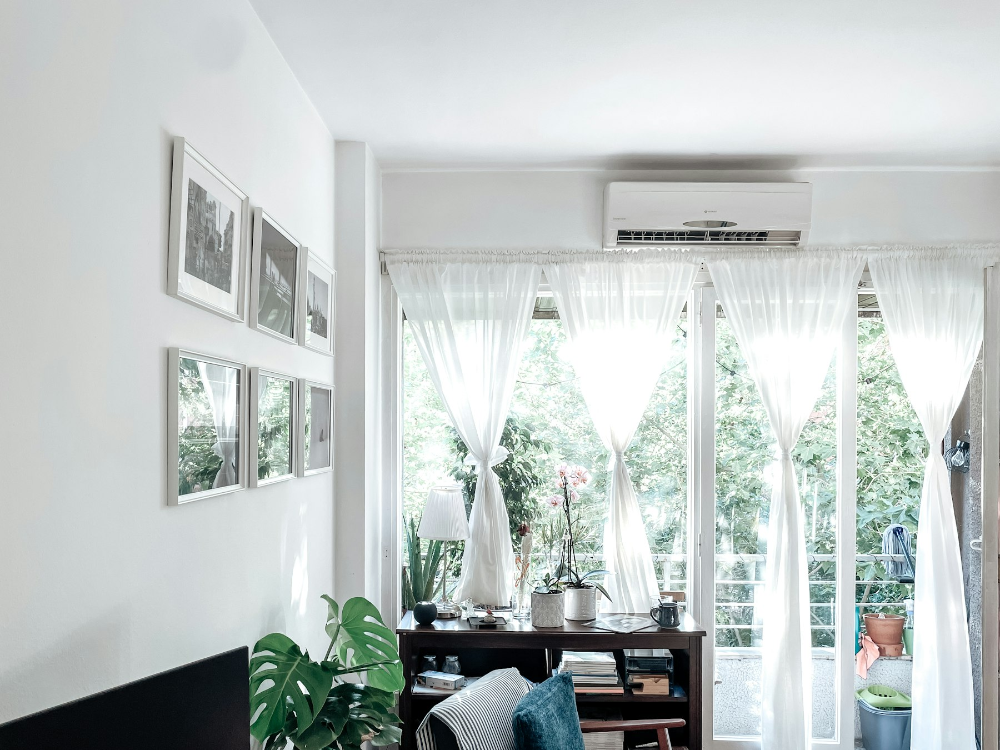
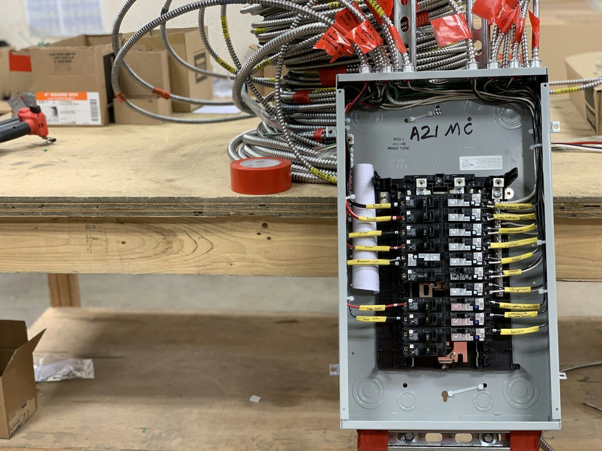

Cold-climate air-source heat pumps now heat homes comfortably through a Toronto winter. The equipment is rarely the hard part. In an older GTA house, what decides whether a heat pump works well is the house itself: how much heat it loses, how the air gets around, and whether the electrical service can carry the load.

## Start with a heat-loss calculation

A heat pump should be sized from a room-by-room heat-loss calculation, which in Canada follows the CSA F280 standard, not from the size of the old furnace. Older furnaces were often oversized, and a heat pump sized the same way will cycle on and off, run less efficiently and feel uneven.

Air sealing and insulation change the answer. Sealing the attic, rim joists and obvious leaks before the heat pump goes in can bring the required size down, which lowers the equipment cost and improves comfort on the coldest days.

## Ducted, ductless or both

- **Ducted.** A central heat pump uses the existing ductwork. Heat pumps deliver air at a lower temperature than a gas furnace and need more airflow to do it, so undersized or leaky ducts in older houses can mean noise and cold rooms. We check duct sizes before choosing equipment.
- **Ductless.** Wall- or ceiling-mounted heads suit houses without ducts, additions and finished attics, or rooms the central system never reached well.
- **A mix.** Many renovations use a ducted system for the main house and a ductless head for an addition or a converted space.

## Electrical capacity

Many older GTA houses still have a 100-amp electrical service. A fully electric system, especially one with electric backup heat, can push past that, and a service upgrade to 200 amps becomes part of the project. A hybrid setup, which keeps a gas furnace for the coldest hours, puts less load on the panel.

Either way, the electrical work needs an ESA permit, and it's worth checking capacity early, before the panel is boxed in by new finishes.

## Where the outdoor unit goes

- **Above the snow line**, on a stand or wall bracket, so it can breathe all winter.
- **Away from walkways.** Defrost cycles drain water that can freeze into ice where people walk.
- **Away from bedroom windows and the neighbours**, for noise.
- **Within the zoning by-law.** Some by-laws limit where mechanical equipment can sit in a side yard, so check before choosing the spot.

## Timing it with a renovation

The best time to switch is when walls and ceilings are already open. Refrigerant lines, condensate drains and new duct runs are far easier to route during a renovation than afterward, and insulation upgrades can happen at the same time.

Rebates for heat pumps and insulation change often, and some require an energy assessment before any work starts. See our guide to [renovation rebates in Ontario](/journal/ontario-home-renovation-rebates), and confirm eligibility before you buy equipment.

## How we handle it

On a whole-home renovation or an addition, we plan the heating with the layout rather than after it. The HVAC contractor, the licensed electrician and, where a furnace stays, a TSSA-registered gas technician are scheduled and supervised as part of the job. If you're weighing a heat pump as part of a larger project, [book a consultation](/contact) and we'll look at the house with you.
