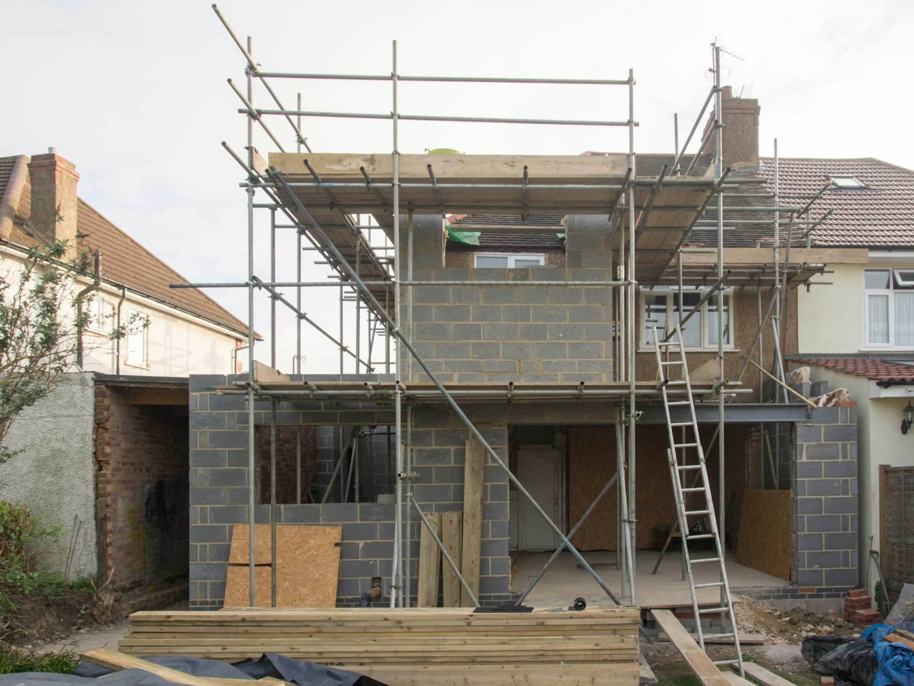

From the first conversation to moving in, most home additions in the GTA take **ten to sixteen months**. About half of that is design and approvals. Construction itself is usually four to eight months, depending on the size of the addition and whether it goes up or back.

Here is where the time goes.

## The phases

| Phase | Typical duration |
| --- | --- |
| Feasibility and design | 6–12 weeks |
| Engineering and permit drawings | 3–6 weeks |
| Building permit review | 6–12 weeks |
| Minor variance, if needed | add 3–6 months |
| Pre-construction and ordering | 2–4 weeks |
| Foundation and framing | 6–10 weeks |
| Roofing, windows and rough-ins | 4–6 weeks |
| Insulation, drywall and finishes | 8–12 weeks |
| Final inspections and handover | 1–3 weeks |

## Design and approvals

The first months produce nothing you can see, and they decide everything. The designer works through your goals, the zoning limits and the existing structure. An engineer sizes beams and footings. Then the drawings go to the building department.

A design that fits within the zoning by-law goes through a standard review. If the addition exceeds the height, setback or coverage limits, it needs a minor variance from the Committee of Adjustment first. That means a public notice, a hearing and an appeal period, and it typically adds three to six months.

## Construction

**Foundation and framing.** Excavation, footings, foundation walls and waterproofing come first, with inspections before backfill. Framing follows quickly. For a second storey, this is when the roof comes off and the house is most exposed.

**Closing in.** Roofing, windows and exterior doors make the addition weathertight. Plumbing, electrical and HVAC are roughed in and inspected.

**Finishes.** Insulation and drywall, then flooring, trim, cabinetry, tile and paint. This is the longest stretch, and it’s where late decisions cause delays.

**Handover.** Final inspections, a walkthrough with you, and a deficiency list completed before the last payment.

## Delays worth planning for

- **Plans examiner comments.** Each round of revisions adds a few weeks. Complete, coordinated drawings reduce them.
- **Long-lead items.** Windows, custom doors, cabinetry and some tile take six to twelve weeks. Order them before you need them.
- **Late selections.** If a tile hasn’t been chosen when the tiler is scheduled, the tiler moves to another job.
- **Weather.** Foundations and roofing are weather-sensitive. Winter starts are possible but slower.
- **What the existing house hides.** Old wiring, undersized beams or a weak foundation can add engineering and work.

## Living through it

Most families stay at home during a rear addition, with some disruption in the rooms next to it. A full second storey usually means moving out for two to three months while the roof is off and the structure is tied in.

For costs and the choice between building up and building back, read [second storey or rear addition](/journal/second-story-vs-rear-addition-gta).
