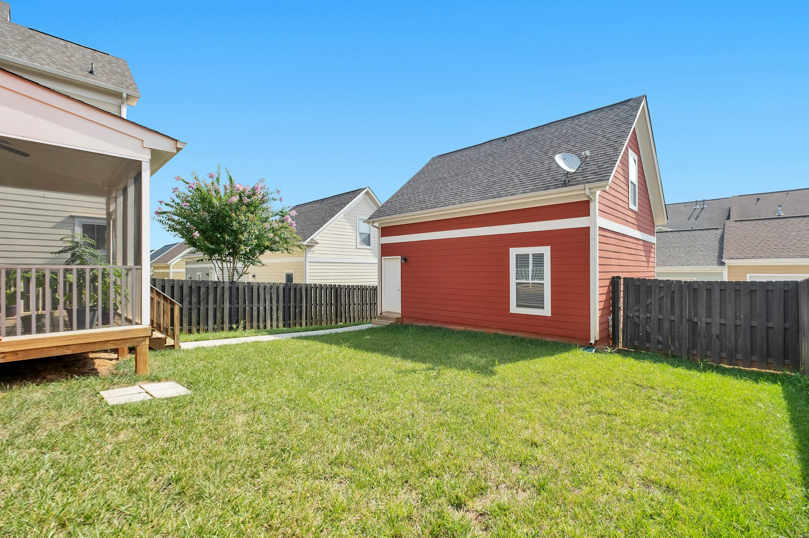

The rules on how many homes you can have on one residential lot have changed more in the last four years than in the forty before. They also now differ city by city, and one change this spring went backwards. Here is where things stand in late 2026 for the cities we build in most.

## The provincial baseline: three units

Since Ontario’s Bill 23 in November 2022, most urban residential lots with full municipal services can have **up to three units as of right**, without a rezoning: for example, the main house, a basement suite and a garden suite. Every GTA municipality has to allow this.

Those added units are also **exempt from development charges**: the second and third units in a detached house, semi or townhouse, and one unit in an accessory building such as a garden suite.

## Toronto: four units everywhere, six in some wards

- **Multiplexes:** since 2023, Toronto allows up to **four units** on residential lots across the city.
- **Sixplexes:** in June 2025, council allowed up to **six units** as of right in nine wards: the eight wards of the Toronto and East York district (Parkdale-High Park, Davenport, Spadina-Fort York, University-Rosedale, Toronto-St. Paul’s, Toronto Centre, Toronto-Danforth and Beaches-East York) and Ward 23, Scarborough North. Other wards can opt in later.
- **Garden and laneway suites** have been permitted since 2022 and 2018, with their own size, setback and fire-access rules.

## Markham: three units, fourplex vetoed

Markham council approved a policy that would have allowed up to four units on many lots. In **March 2026 the mayor revoked it** using strong mayor powers, citing pressure on roads, parking and servicing. The provincial three-unit baseline still applies, so a house with a basement suite and a garden suite remains possible; a fourth unit is not, without a rezoning.

If you saw a post earlier this year saying Markham now allows fourplexes, it is out of date.

## Richmond Hill and Vaughan: three units

Both cities allow the provincial three units, under their own zoning rules for size, height, parking and setbacks. Neither has adopted four units as of right.

**Vaughan** council voted in April 2026 to temporarily reduce residential development charges. Added units are already exempt, but if you’re planning a new custom home or a larger project there, ask the city for the rate that applies at permit time.

## Before you plan a third or fourth unit

1. **Check the zoning on your lot.** As of right doesn’t mean anything goes: height, setbacks, lot coverage, parking and, for garden suites, distance from the house and fire access all still apply.
2. **Check servicing.** Water, sewer and electrical capacity often need upgrades for more units.
3. **Check trees.** Protected trees can rule out a garden suite location. See [tree permits before you build](/journal/tree-permits-before-you-build).
4. **Plan the financing.** CMHC-insured refinancing can fund a suite based on the finished value of the home. See [financing a secondary suite](/journal/financing-a-secondary-suite).

## Where to go from here

For the details of a second or third unit in York Region, read [adding a second or third unit](/journal/additional-residential-units-york-region). For Toronto’s backyard options, see [basement suite or laneway suite](/journal/basement-suite-vs-laneway-suite-toronto).

We check zoning, trees and servicing on your lot before you pay for design. [Send us your address](/contact?service=laneway-garden-suites) and we’ll tell you what you can build.

Rules here reflect council decisions reported up to November 2026. Zoning changes often; confirm with your city before you rely on it.
