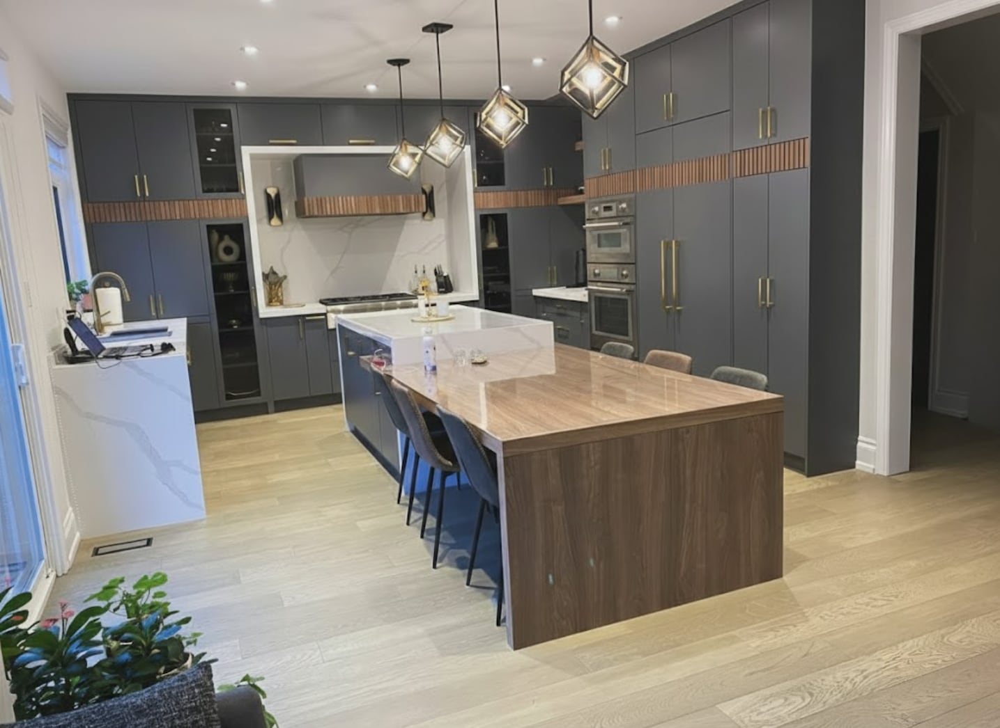
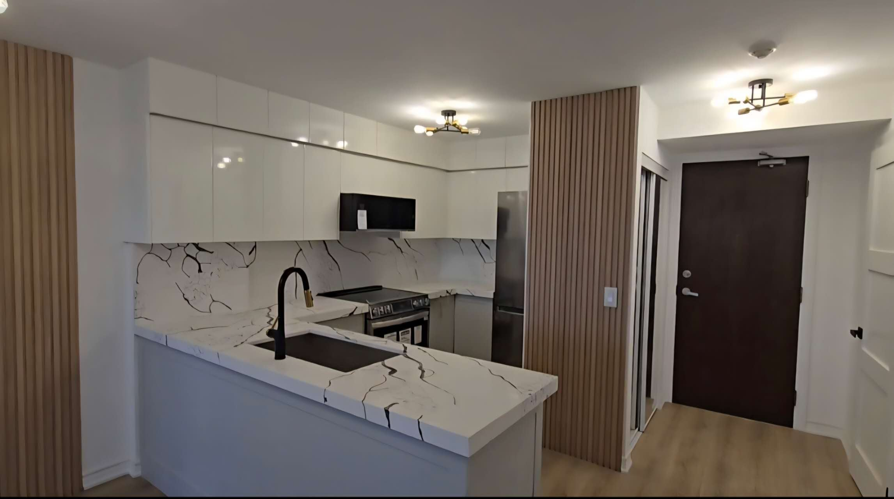

Most full kitchen renovations in the GTA land between **$45,000 and $90,000**. Kitchens that move walls or plumbing, run custom cabinetry to the ceiling, or use a stone slab for the backsplash usually pass **$100,000**. A refresh that keeps the cabinet boxes and the layout can come in under $35,000.

Those ranges include design, demolition, cabinetry, counters, backsplash, flooring, lighting, electrical and plumbing work, and installation. They don’t include appliances, which run anywhere from $8,000 for a solid standard package to $40,000 or more for panel-ready and professional ranges. All figures are before 13% HST.

## Three budgets, three different kitchens

| Level | Typical cost | What it usually means |
| --- | --- | --- |
| Refresh | $15,000–$35,000 | New doors or painted cabinets, new counters and backsplash, sink, faucet and lighting. Layout and cabinet boxes stay. |
| Full renovation, same layout | $45,000–$90,000 | New cabinetry, quartz counters, backsplash, flooring, lighting and electrical updates. Sink and range stay roughly where they are. |
| Full renovation, new layout | $90,000–$150,000+ | Everything above, plus walls removed or moved, plumbing or gas relocated, custom cabinetry, slab backsplash, permit and engineering. |

The jump between the second and third rows isn’t about nicer finishes. It’s about moving things that are hidden in walls and floors: drains, vents, gas lines, structure. That work is what makes a kitchen more expensive, and it’s also what makes a bad layout good.

## Where the money goes

In a typical mid-range renovation, the budget splits roughly like this:

- **Cabinetry:** 30–40%. The single biggest line, and the one with the longest lead time.
- **Installation and trades:** 20–30%. Demolition, carpentry, drywall, tile and finishing.
- **Counters and backsplash:** 10–15%. More if the backsplash is a slab or the island has waterfall ends.
- **Flooring:** 5–10%. Less if existing hardwood can be refinished.
- **Electrical and lighting:** 5–10%. Dedicated appliance circuits, pot lights, under-cabinet lighting and outlets.
- **Plumbing and gas:** 3–8%. Mostly reconnection unless fixtures move.
- **Design, permits and contingency:** 5–10%.

## What pushes the price up

**Moving the sink or range.** A sink on a new wall needs a new drain and vent, which may mean opening a ceiling below. A range in a new spot may need a new gas line. Expect $3,000 to $10,000 depending on access, and a permit in most cases.

**Removing a wall.** A partition wall is straightforward. A load-bearing wall needs an engineer, a beam, posts and sometimes new footings in the basement, plus a building permit. Budget $10,000 to $30,000 or more for that work alone. Our guide on [removing a load-bearing wall](/journal/removing-a-load-bearing-wall) explains why the range is so wide.

**Cabinetry details.** Uppers to the ceiling, custom sizes, inset doors, interior drawers and lighting inside glass cabinets all add up. They’re often worth it, but they’re choices, not defaults.

**Ventilation.** A hood that actually clears cooking smoke should be ducted outside. Large hoods can require make-up air so they don’t pull exhaust back from a gas furnace or water heater, which adds several thousand dollars. If your family cooks with high heat, read our [wok kitchen guide](/journal/wok-kitchen-ventilation) before choosing a hood.

**What’s behind the walls.** Older houses can hide a 100-amp panel with no spare capacity, knob-and-tube wiring or galvanized pipes. You can’t price these until walls open, which is why a good quote carries a contingency. We wrote about [what we find inside older GTA homes](/journal/older-home-surprises).

**Condo rules.** Elevator bookings, restricted working hours, floor protection and board approvals add time, and time costs money.

## Where you can save without it looking cheaper

- **Keep a layout that works.** If the sink, range and fridge are already in sensible places, leave them there and spend the money on cabinetry and lighting.
- **Spend on boxes and hardware, not door style.** Plywood boxes, good hinges and full-extension drawers are what you feel every day. A simple shaker door looks good for decades.
- **Choose a standard quartz.** Many mid-priced quartz colours look as good as premium ones once installed.
- **Refinish the floor.** In our [Richmond Hill kitchen](/projects/kitchen-renovation-richmond-hill) the original hardwood was refinished instead of replaced, which freed budget for taller cabinets.
- **Pick appliances early.** Cabinets are built around appliance dimensions. Changing a fridge late can mean remaking a cabinet.

## Three real kitchens

- Our [Richmond Hill kitchen](/projects/kitchen-renovation-richmond-hill) kept the island where it was, added full-height cabinetry and refinished the floors. Five weeks on site.
- Our [Etobicoke kitchen](/projects/kitchen-renovation-etobicoke) added a full-height quartz backsplash, a waterfall island with a prep sink and lit glass cabinets. Ten weeks.
- Our [charcoal and walnut kitchen in Toronto](/projects/luxury-kitchen-renovation-toronto) kept the footprint but replaced everything inside it, including a two-part island. Eight weeks.

## How long it takes

Plan on three to six weeks for design and selections, four to eight weeks for cabinets to be made, and five to nine weeks on site. We do demolition and rough-in work while the cabinets are being built, so you aren’t without a kitchen for the full lead time.

## Before you sign anything

Ask every contractor the same questions so you can compare their answers:

1. Is the quote itemized, and which lines are allowances rather than fixed prices?
2. Are appliances included or separate?
3. Who applies for the permit, if one is needed?
4. What happens, and who decides, if something unexpected turns up behind a wall?
5. Who is on site day to day, and who do I call?

Our guide on [how to compare renovation quotes](/journal/how-to-compare-renovation-quotes) goes through these in more detail.
