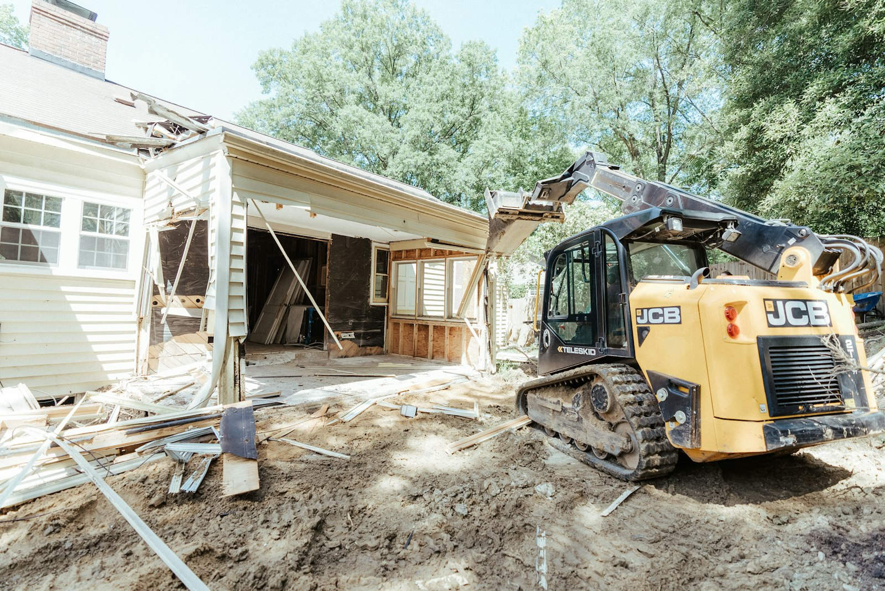

A two-storey laneway or garden suite in Toronto typically costs **$350,000 to $600,000** all in, including design, engineering, permits and construction. Single-storey suites and simple designs come in lower. Long service runs, tree protection, poor access and premium finishes push the number up.

That’s a lot of money for a small building, and the reason is simple: a suite is a complete house. It has its own foundation, structure, roof, windows, insulation, heating and cooling, kitchen and bathroom, all built in a backyard that a truck often can’t reach.

## Where the money goes

| Part of the project | Share of budget |
| --- | --- |
| Design, engineering, surveys and permits | 10–15% |
| Foundation and site work | 10–15% |
| Framing, roof, windows and exterior | 25–30% |
| Plumbing, electrical, HVAC and service connections | 15–20% |
| Interior finishes, kitchen and bathroom | 20–25% |

## What makes one suite cost more than another

**Servicing.** Water, sewer and power usually come from the main house. The farther the suite is from the house, the longer and more expensive those runs are, and if the main house’s electrical service is already near capacity, it may need an upgrade.

**Access.** Laneway lots can usually be reached from the lane. Garden suites often can’t, which means materials move by hand or by small equipment through a side yard.

**Trees.** Toronto protects private trees 30 cm and larger in diameter, and their root zones. A protected tree can move the suite, change the foundation design, or require hand digging. See [tree permits before you build](/journal/tree-permits-before-you-build).

**Fire access.** Firefighters need a route to the suite, either from the lane or along a path from the street. The permitted path length and width are among the first things a plans examiner checks.

**Size and height.** Toronto’s rules set limits on height, footprint and separation from the main house, and they were updated in 2025. The size you can build follows from the lot, not the other way around.

## Costs you may avoid

Under provincial rules introduced in 2022, an additional residential unit in a building ancillary to a detached, semi-detached or townhouse is exempt from development charges. Toronto has also waived parkland fees for these suites. That can save tens of thousands of dollars compared to rules from a few years ago.

## Is your lot eligible?

Before paying for design, check:

1. Does the lot abut a public lane (laneway suite) or have enough rear yard (garden suite)?
2. Is there a clear fire access route that meets the current requirements?
3. Are there protected trees on your lot or your neighbours’ lots near the likely footprint?
4. Can water, sewer and power reach the suite without unusual cost?
5. Is the property in a ravine-protected or heritage area?

We do this check as the first step on every suite project. If the lot doesn’t work, you find out for the cost of a site visit rather than a set of drawings.

## Renting it, or not

Many owners build a suite for rental income. Just as many build one for family: a parent who wants independence close by, or an adult child who can’t afford to buy. If you’re weighing a suite against a basement unit, read [basement suite or laneway suite?](/journal/basement-suite-vs-laneway-suite-toronto).
