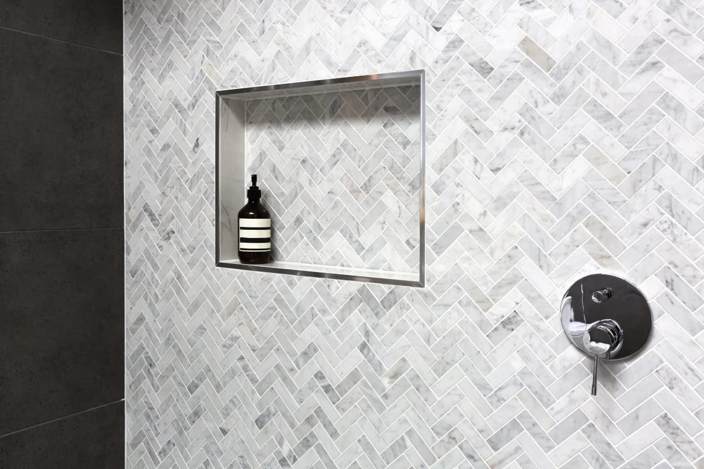

A primary bathroom renovation is one of the most personal projects in a house, and one of the easiest to overspend on. These are the features we see clients use every day for years, and the ones that tend to disappoint.

## Worth it

**A walk-in shower, ideally curbless.** A generous shower with no step is the feature people mention most after the renovation. It looks clean, it’s easy to clean, and it works at every age. It needs careful floor framing and waterproofing to slope water to the drain without a curb, which is where the cost goes.

**A linear drain.** It lets the floor slope in one direction, which makes large-format tile and curbless entries much easier to do well.

**Heated floors.** Electric radiant heat under tile is inexpensive to add during a renovation and is used every winter morning.

**A properly sized, quiet exhaust fan.** Ducted outside, on a humidity sensor or timer. It protects every other dollar you spend in the room.

**A double vanity, if the wall allows it.** For couples, two sinks remove a daily bottleneck. It needs roughly five feet of vanity wall or more.

**Good mirror lighting.** Light at face height, on both sides of the mirror or integrated into it, rather than only a fixture overhead.

**Niches and storage planned with the tile.** A niche where the bottles actually go, and a medicine cabinet or tall linen storage, keep counters clear.

## Worth it in the right room

**A freestanding tub.** Beautiful, and good in listing photos, but many households rarely use it. If there’s room for both a large shower and a tub, enjoy it. If space is tight, give it to the shower. Keep at least one tub in the house if you have young children.

**A bench in the shower.** Useful now, more useful later. Built-in benches need careful waterproofing.

## Usually not worth it

**Steam showers.** They need a vapour-tight enclosure, a generator, dedicated electrical and very careful waterproofing, and most are used rarely.

**Jetted tubs.** Noisy, hard to clean, and largely out of favour with buyers.

**Very trend-specific tile.** A bold pattern can be wonderful, but it dates a bathroom faster than anything else. Use it on one wall or a floor, not everywhere.

## Things to decide early

- **Toilet location.** Moving it is the single biggest cost driver in a layout change.
- **Shower glass.** Frameless glass is measured after tile is finished, so it’s often the last thing installed.
- **Blocking for grab bars.** Even if you don’t want them now, wood blocking in the walls makes them easy to add later.

For prices, read [what a bathroom renovation costs in the GTA](/journal/bathroom-renovation-cost-gta).
