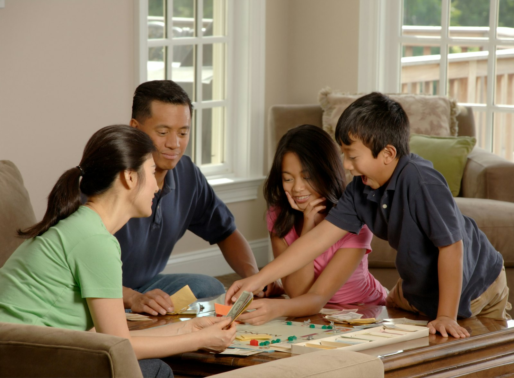

More GTA families are living with three generations under one roof: grandparents who help raise the children, adult children who can’t afford to buy, or parents who need care nearby. It works best when the house is designed for it, not adapted room by room.

## Decide how independent each household should be

Multigenerational homes sit on a spectrum:

1. **Shared house, private rooms.** One kitchen, one front door, a bedroom and bathroom for each generation.
2. **Semi-independent.** A suite with its own bathroom and sitting room, sometimes a kitchenette, sharing the main entrance and kitchen.
3. **Fully independent.** A legal second unit with its own entrance, kitchen and address, in the basement, an addition or a garden suite.

The further along the spectrum, the more privacy, and the more it costs. Families often find that the second option suits daily life best, with the third option kept in mind for later.

## Put the oldest generation on the main floor

Stairs are the biggest barrier as people age. A main-floor bedroom with an accessible bathroom is the single most useful feature in a multigenerational home. In an existing house, that often means a rear addition or converting a main-floor room. In a new custom home, it’s easy to plan from the start.

Details that make a main-floor suite work for decades:

- A curbless shower with a bench and grab-bar blocking in the walls
- Doors at least 36 inches wide and lever handles
- A level entry from the driveway or garage, or space for a future ramp
- Good lighting, including night lighting to the bathroom

## Two kitchens, or a second cooking space

Different generations often cook differently and at different times. A second kitchen, or a [wok kitchen](/journal/wok-kitchen-ventilation) for heavy cooking, lets everyone cook without conflict. If one kitchen is in a separate legal unit, it needs to meet the code for that unit.

## Privacy and sound

Sound is what makes or breaks shared living. Insulate interior walls and floors between suites, use solid-core doors, and avoid putting a bedroom under the main kitchen or family room.

## A legal unit gives you options

Since 2022, Ontario allows up to three units on most urban residential lots, and additional units are exempt from development charges. Building a family suite as a legal unit costs more upfront, but it can be rented later if the family’s needs change. Read [adding a second or third unit](/journal/additional-residential-units-york-region).

## Tax credits

The federal Multigenerational Home Renovation Tax Credit returns 15 percent of up to $50,000 in eligible costs for creating a secondary unit for a family member aged 65 or older, or an adult eligible for the disability tax credit. The Home Accessibility Tax Credit can help with accessibility work. See [renovation rebates and tax credits](/journal/ontario-home-renovation-rebates).

## Where to start

Talk through how a typical day would go: who wakes first, who cooks, who needs quiet, who comes and goes. The design follows from that. We can walk your house with your family and sketch what each option would look like.
