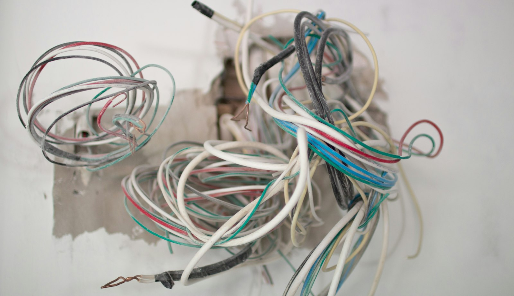

Every renovation contractor has a story about the wall they opened. In older GTA houses the surprises are predictable enough that you can plan for most of them. This is what we look for, roughly by the age of the house.

## Electrical

**Knob-and-tube wiring** (houses built before about 1950). Ceramic knobs and tubes carrying ungrounded wires through walls and floors. It was well made, but the insulation is now old, it has no ground, and many insurers won’t cover a house that still has it. Once walls are open, replacing it is the obvious move.

**Aluminum branch wiring** (some houses from the mid-1960s to late 1970s). Not dangerous in itself, but connections can loosen and overheat. It needs the right connectors and devices, and an electrician should assess it.

**Undersized service.** Many older houses have 60- or 100-amp service. A new kitchen, a heat pump, an EV charger or a second unit can push past it. A service upgrade involves the utility and takes time to schedule, so plan it early.

## Plumbing

**Galvanized steel supply pipes** (common before the 1960s). They corrode from the inside, reducing water pressure and eventually leaking. If you’re opening walls, replace them.

**Lead water service.** Many Toronto homes built before the mid-1950s were connected to the city main with a lead service pipe. The City of Toronto replaces its portion; the homeowner’s portion from the property line to the house is yours. If you have an older home, check, especially if you have young children.

**Cast iron and clay drains.** Old cast iron stacks crack, and clay sewer laterals let in tree roots. A camera inspection of the drain before a renovation costs little and can save a basement.

## Hazardous materials

**Asbestos.** It can be found in vermiculite attic insulation, old plaster and textured ceilings, 9-inch floor tiles, pipe wrap and some drywall compound. If materials that might contain it will be disturbed, they should be tested first. If asbestos is present, Ontario regulations set out how it must be removed, and it’s a job for licensed specialists, not general trades.

**Lead paint.** Common in houses painted before the 1970s. Sanding or scraping it creates dust that needs proper containment.

## Structure

- **Notched or cut joists** from past plumbing and wiring work
- **Undersized beams** where a previous owner removed a wall
- **Foundation cracks and efflorescence**, often from poor drainage outside
- **Old renovations without permits**, which may need to be opened and brought up to code

## How to budget for it

Before you start:

1. **Ask your contractor what they expect to find** based on the age of the house, and price the likely items up front.
2. **Test before demolition** for asbestos where it’s plausible.
3. **Carry a contingency.** Ten percent is a sensible minimum for a pre-1960 house, more for a deep renovation.
4. **Agree on the process.** When something is found, the contractor should stop, show you, price it, and get your written approval before proceeding.

That last point is the most important. Surprises are normal in older houses. Surprise invoices shouldn’t be. Read [how to compare renovation quotes](/journal/how-to-compare-renovation-quotes) for how to spot a contractor who has planned for this.
