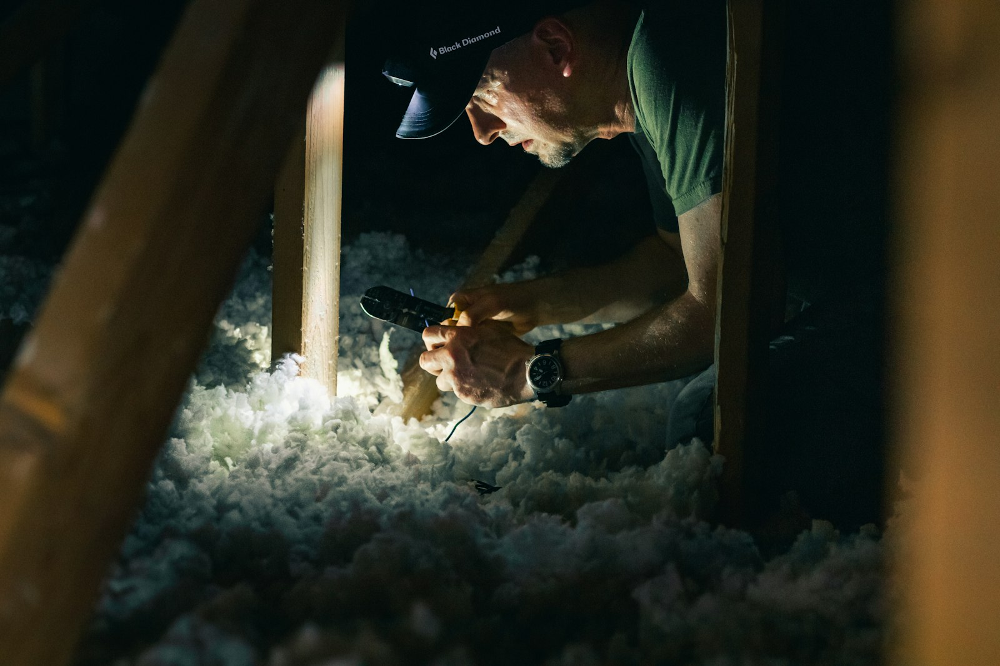

Rebates rarely pay for a renovation, but they can take thousands of dollars off insulation, heat pumps and windows, and federal tax credits can return a meaningful share of building a suite for a family member. The catch is timing: several programs require you to act before the work starts.

Programs change often. Treat this as a map, and confirm current details with the program before you rely on them.

## Ontario’s Home Renovation Savings Program

Launched in January 2025 and delivered by Enbridge Gas and Save on Energy with the Ontario government, this is the main energy rebate program for Ontario homeowners. It covers upgrades such as:

- **Insulation** in attics, exterior walls, basements and crawl spaces
- **Air sealing**
- **Heat pumps**, both air-source and ground-source
- **Windows and doors**, paid per opening
- **Smart thermostats** and some appliances

There are two routes. One requires a home energy assessment before and after the work and rewards multiple upgrades together. The other allows certain upgrades, such as heat pumps, on their own without an assessment. If you’re doing a whole-home renovation, the assessment route is often worth it, but the **first assessment must happen before work begins**.

## Federal tax credits

**Multigenerational Home Renovation Tax Credit.** If you build a secondary unit so that a family member aged 65 or older, or an adult eligible for the disability tax credit, can live with you, you can claim 15 percent of up to $50,000 in eligible costs, for a credit of up to $7,500. It applies to basement suites, additions and garden suites built for that purpose.

**Home Accessibility Tax Credit.** Renovations that make a home safer and more accessible for someone 65 or older, or someone eligible for the disability tax credit, can qualify for a credit of 15 percent on up to $20,000 of expenses per year. Ramps, grab bars, walk-in showers, wider doorways and stair lifts are typical examples.

Keep every invoice and confirm eligibility with your accountant.

## Development charges on additional units

Not a rebate, but a large saving: under Ontario’s 2022 housing rules, second and third units in a house, and an additional unit in an accessory building, are exempt from development charges. See [adding a second or third unit](/journal/additional-residential-units-york-region).

## Municipal programs

Some municipalities run their own programs, such as low-interest energy retrofit financing repaid through the property tax bill, and repair programs for lower-income and disabled homeowners delivered through local housing offices. Availability changes year to year, so check with your city before planning around one.

## What has ended

The federal Canada Greener Homes Grant closed to new applicants in 2024. Older articles still describe it. If a contractor quotes a project assuming that grant, ask them to check.

## How to get the most from them

1. **Decide early** which energy upgrades belong in your renovation.
2. **Book the energy assessment before demolition** if you’re using the assessment route.
3. **Keep the paperwork:** invoices, product model numbers and installation dates.
4. **Ask your contractor to itemize** eligible work separately on the invoice.

We point out rebate opportunities during planning and itemize our invoices so eligible work is easy to claim. If you’re renovating an older house, read [what we find inside older GTA homes](/journal/older-home-surprises) too; insulation and air sealing are often the cheapest time to fix a draughty house.
