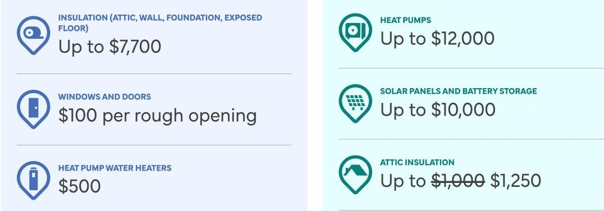

Ontario’s main renovation rebate is the Home Renovation Savings Program, delivered by Enbridge Gas and Save on Energy with the Ontario government. It pays up to $12,000 for a heat pump, up to $7,700 for insulation and $100 for each new window or door, and several of its rebates have **deadlines on November 30, 2026**.

Rebates rarely pay for a whole renovation, but together with federal tax credits they can take thousands of dollars off insulation, heat pumps, windows and family suites. The catch is timing: several programs require you to act before the work starts. Programs change often, so treat this as a map and confirm the details with each program before you rely on them.

## Home Renovation Savings: what it pays

| Upgrade | Maximum rebate | Energy assessment needed |
| --- | --- | --- |
| Insulation (attic, walls, foundation, exposed floor) | $7,700 | Yes |
| Windows and doors | $100 per opening | Yes |
| Heat pump water heater | $500 | Yes |
| Air sealing | $250 | Yes |
| Heat pumps | $12,000 | No |
| Solar panels and battery storage | $10,000 | No |
| Attic insulation | $1,250 | No |
| Smart thermostat | $125 | No |

The upgrades that need an assessment only qualify **in combinations of two or more**, so windows can’t be claimed on their own. You have an energy assessment before the work and another after it, and the first one **must happen before work begins**. For a whole-home renovation this route is usually worth it.

## Who qualifies

- You own the home.
- You’re an Enbridge Gas customer heating mainly with a gas furnace or boiler, or you’re on the Ontario electricity grid and heat with electricity, oil, propane or wood.
- The home is detached, semi-detached, a row or townhouse (not a stacked townhouse), or a mobile home on a permanent foundation.
- New homes occupied for six months or less don’t qualify.

## 2026 deadlines

The program’s terms set firm dates for this year:

- **Upgrades that need an assessment:** the assessment after the work must be **booked by November 30, 2026**, and completed by December 31, 2026, or within 180 days of the first assessment if that comes first.
- **Attic insulation without an assessment:** the work must be **completed by November 30, 2026**, by a participating contractor.
- **Smart thermostat rebate:** ends **December 31, 2026**.
- **Heat pumps, solar and battery storage:** no end date is published; rebates are paid until each stream’s funding runs out.

The program hasn’t announced what happens after 2026. We’ll update this guide when it does.

## What to do now

1. **If you’ve had your first assessment,** book the second one now so it’s in the system before November 30.
2. **If you want attic insulation,** have a participating contractor finish it this month.
3. **If you haven’t started,** the assessment route is out of time for this year, but heat pumps have no deadline yet.
4. **Watch for scams.** The program warns about fake websites and people posing as participating contractors. Apply only through homerenovationsavings.ca.

## Federal tax credits

**Multigenerational Home Renovation Tax Credit.** If you build a secondary unit so that a family member aged 65 or older, or an adult eligible for the disability tax credit, can live with you, you can claim 15 percent of up to $50,000 in eligible costs, for a credit of up to $7,500. It applies to basement suites, additions and garden suites built for that purpose.

**Home Accessibility Tax Credit.** Renovations that make a home safer and more accessible for someone 65 or older, or someone eligible for the disability tax credit, can qualify for a credit of 15 percent on up to $20,000 of expenses per year. Ramps, grab bars, walk-in showers, wider doorways and stair lifts are typical examples.

Keep every invoice and confirm eligibility with your accountant.

## Development charges on additional units

Not a rebate, but a large saving: under Ontario’s 2022 housing rules, second and third units in a house, and an additional unit in an accessory building, are exempt from development charges. See [adding a second or third unit](/journal/additional-residential-units-york-region).

## Municipal programs

In Toronto, the largest is the basement flooding subsidy, now up to $6,650 per property for backwater valves, sump pumps and related work. See [Toronto’s basement flooding subsidy](/journal/toronto-basement-flooding-subsidy).

Some municipalities also offer low-interest energy retrofit financing repaid through the property tax bill, and repair programs for lower-income and disabled homeowners. Availability changes year to year, so check with your city before planning around one.

## Financing a suite

If you’re adding a basement or garden suite, CMHC-insured refinancing lets you borrow against the value your home will have once the suite is built. See [financing a secondary suite](/journal/financing-a-secondary-suite).

## What has ended

The federal Canada Greener Homes Grant closed to new applicants in 2024. Older articles still describe it. If a contractor quotes a project assuming that grant, ask them to check.

The federal Canada Secondary Suite Loan Program, announced in 2024 as loans of up to $80,000 at 2 percent, never opened for applications and was dropped in the 2025 federal budget. Posts still circulate describing it as available.

## How to get the most from them

1. **Decide early** which energy upgrades belong in your renovation.
2. **Book the energy assessment before demolition** if you’re using the assessment route.
3. **Keep the paperwork:** invoices, product model numbers and installation dates.
4. **Ask your contractor to itemize** eligible work separately on the invoice.

We point out rebate opportunities during planning and itemize our invoices so eligible work is easy to claim. If you’re renovating an older house, read [what we find inside older GTA homes](/journal/older-home-surprises) too; insulation and air sealing are often the cheapest time to fix a draughty house.

Program details are from the Home Renovation Savings website and its terms, as of November 2026.
