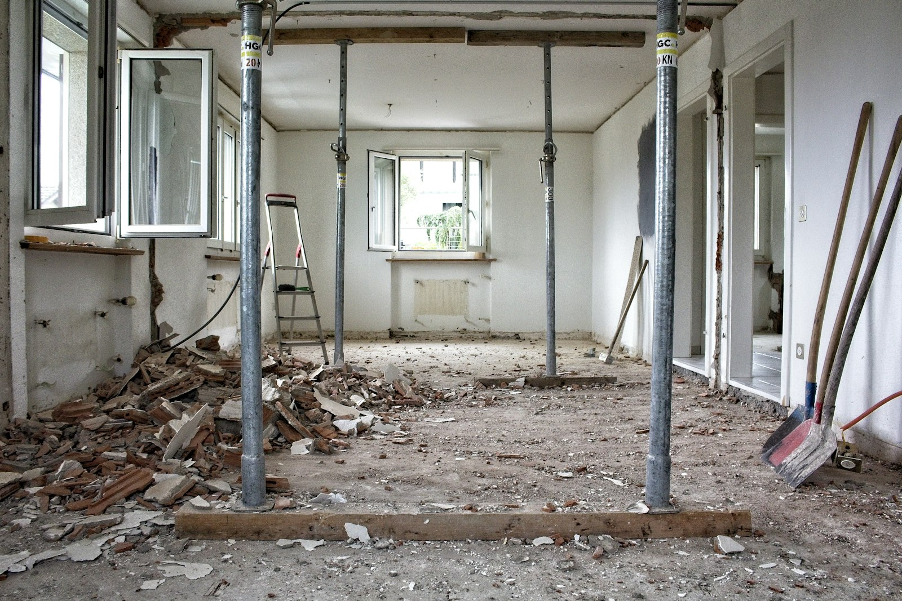

Opening a closed kitchen to the living and dining rooms is the most common layout change in GTA renovations. When the wall in the way is a partition, it’s a few days of work. When it carries the floor or roof above, it’s an engineered structural change, and it needs to be treated like one.

## Is the wall load-bearing?

Only an engineer or an experienced contractor looking at the structure can say for sure, but there are reliable clues:

- **Joist direction.** In the basement or attic, look at which way the joists run. A wall running perpendicular to the joists, especially near the middle of the house, is often supporting them.
- **What’s below it.** A wall sitting directly over a beam, a foundation wall or a line of posts in the basement is usually bearing.
- **What’s above it.** A wall stacked under another wall on the floor above is often carrying load from it.
- **Centre-hall plans.** In many 1950s to 1980s GTA houses, the wall between the kitchen and the dining or family room is the main bearing line.

Plumbing stacks, ductwork and wiring are often inside the same wall, and moving them is part of the job.

## How it’s done

1. **Engineering.** A structural engineer sizes a beam and its supports, and the design goes into the permit drawings.
2. **Permit.** Removing a bearing wall is structural work and needs a building permit in every GTA municipality.
3. **Temporary shoring.** Temporary walls go up on both sides to hold the floor or roof while the old wall comes out.
4. **The beam.** The new beam goes in, with posts at each end.
5. **The load path.** The posts must carry the load all the way to the foundation. That can mean new footings in the basement, which is the part people don’t expect.
6. **Inspection.** The framing is inspected before it’s closed in.
7. **Finishing.** Drywall, flooring repairs where the wall stood, and any relocated ducts, pipes and wiring.

## Beam options

**Dropped beam.** The beam sits below the ceiling, leaving a visible bulkhead. It’s the simplest and least expensive option.

**Flush beam.** The beam sits up in the floor system, so the ceiling stays flat. The joists are cut and hung from the beam with metal hangers. It costs more and takes longer, but it’s usually what people mean when they say “open concept”.

**Material.** Engineered wood (LVL) beams are common for moderate spans. Longer spans or heavy loads call for steel, which is smaller for the same strength but harder to bring into the house and install.

## What it costs

For a typical GTA house, removing a load-bearing wall and installing a new beam runs from about **$10,000 to $30,000**, including engineering and the permit. The range is wide because of:

- span length and beam material
- dropped versus flush beam
- new footings in the basement
- plumbing stacks or ductwork that need rerouting
- flooring that has to be patched or replaced where the wall stood

That figure is for the structural work. Finishing the new open space, including the kitchen, is separate.

## Is it worth it?

Usually, yes, in houses where the kitchen is cut off from the rest of the main floor. It changes how a family uses the house more than almost any other single decision. It’s worth thinking about the trade-offs, though: open plans carry noise and cooking smells, and a family that cooks with high heat needs a strong ventilation plan. See our [wok kitchen guide](/journal/wok-kitchen-ventilation) and [kitchen layouts for GTA homes](/journal/best-kitchen-layouts-gta-homes).
