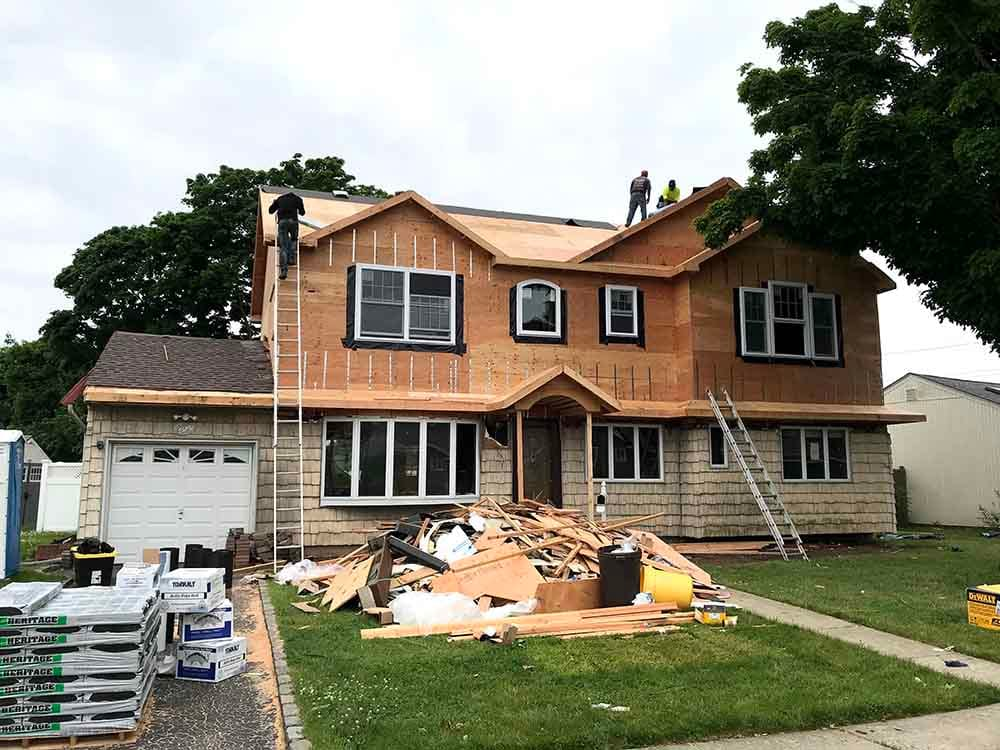

When a house no longer fits, most families in the GTA have three choices that keep them on the same lot: renovate what’s there, add space to it, or take it down and build new. Each can be the right answer. The wrong one costs years and hundreds of thousands of dollars.

Here is how we help clients decide, usually in the first site visit.

## Start with what’s wrong with the house

Write down what you would change if money were no object, then sort it into three groups:

- **Layout problems.** A closed kitchen, a dark centre hall, too few bathrooms, bedrooms in the wrong place.
- **Space problems.** Not enough bedrooms, no room for a parent to move in, nowhere to work.
- **Condition problems.** An old foundation, a tired roof, 60-amp electrical, galvanized plumbing, single-pane windows.

Layout problems point to renovation. Space problems point to an addition. When a house has all three, especially condition problems in the structure itself, rebuilding starts to make sense.

## The rough economics

| Option | Typical cost per sq ft | Typical timeline, including permits |
| --- | --- | --- |
| Renovate | $150–$400 | 4–9 months |
| Add on | $350–$600 of new space | 8–14 months |
| Rebuild | $400–$700+ | 14–24 months |

The useful comparison isn’t the per-square-foot number. It’s what you end up with. A $500,000 renovation of a 1960s bungalow still leaves you with a 1960s foundation, ceiling heights and envelope. A $1.5 million rebuild gives you a new house with a full warranty, but you’ll live somewhere else for well over a year.

## Five questions that usually settle it

**1. How much of the house would you change?** If the plan touches more than about two-thirds of the floor area and includes the structure, a rebuild is often within 25 to 35 percent of the renovation cost, for a much better result.

**2. What does zoning allow?** Your lot may permit a house far larger than the one on it, or the existing house may already exceed today’s limits. An older house that is “legal non-conforming” can sometimes be renovated in a way a new house could not be built. Check before deciding.

**3. What’s the foundation like?** A sound foundation is a strong argument for keeping the house. A failing one, or a basement too low to use, tilts toward rebuilding, because fixing it is expensive and invisible.

**4. Where will you live?** A rear addition or a phased renovation can often be done with the family at home. A second storey usually means moving out for two to three months. A rebuild means moving out for a year or more.

**5. How long will you stay?** Rebuilding pays off over a long horizon. If you expect to sell in five years, a focused renovation that fixes the worst problems is usually the better investment.

## Things people forget to compare

- **Trees.** A protected tree can block an addition or shape the footprint of a new house. See [tree permits before you build](/journal/tree-permits-before-you-build).
- **Development charges.** Generally credited when you replace an existing house, so they aren’t a reason to avoid rebuilding.
- **New-home warranty.** A new house carries Ontario’s statutory warranty; a renovation carries the contractor’s workmanship warranty. Read [HCRA vs Tarion](/journal/hcra-vs-tarion-ontario-homeowner-guide).
- **A second unit.** All three options can include one. A basement unit, an addition with a separate entrance or a garden suite can change the economics. See [adding a second or third unit](/journal/additional-residential-units-york-region).

## What we do in a first visit

We walk the house and the lot, look at the foundation and mechanicals, check the zoning limits, and talk through what each option would look like and roughly cost. Often the answer is obvious once it’s laid out. When it isn’t, a feasibility study with a designer is a small cost compared to choosing wrong.

If you’re leaning toward an addition, read [second storey or rear addition](/journal/second-story-vs-rear-addition-gta). If you’re leaning toward a new house, read [what a custom home costs](/journal/custom-home-cost-gta).
