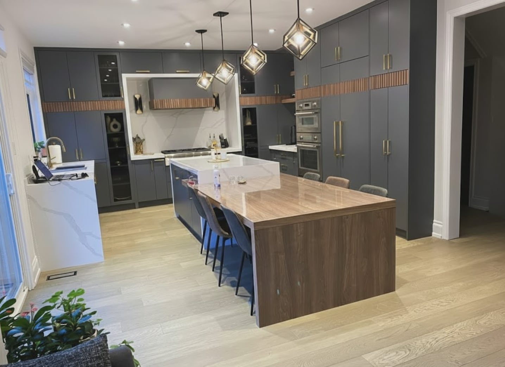

The first thing most homeowners want to know is roughly what their project will cost. These are the ranges we see most often when pricing work across the GTA, before HST (13 percent in Ontario) and without appliances.

## Costs at a glance

| Project | Typical cost |
| --- | --- |
| Kitchen, same layout | $45,000–$90,000 |
| Kitchen, new layout with walls, plumbing and custom cabinetry | $90,000–$150,000+ |
| Main bathroom, full renovation | $25,000–$45,000 |
| Primary ensuite | $45,000–$90,000 |
| Finished basement | $70–$110 per sq ft |
| Legal basement suite | $120,000–$200,000 |
| Rear addition | $150,000–$350,000 |
| Second-storey addition | $300,000–$600,000 |
| Laneway or garden suite | $350,000–$600,000 |
| Custom home, knock-down rebuild | $400–$700+ per sq ft, not including land |

Every project is different, so use these only for early planning. Your price comes from a written, itemized quote after we’ve seen the house. Our detailed guides break each one down: [kitchens](/journal/kitchen-renovation-cost-gta), [bathrooms](/journal/bathroom-renovation-cost-gta), [basements](/journal/basement-renovation-cost-gta), [additions](/journal/second-story-vs-rear-addition-gta), [laneway suites](/journal/laneway-suite-cost-toronto) and [custom homes](/journal/custom-home-cost-gta).

## Why two quotes for the same kitchen can be so far apart

**Whether the layout changes.** Moving the sink or range means new drains, venting or gas lines; removing a load-bearing wall needs an engineered beam and a building permit. This work you never see is what separates one budget from another.

**Cabinetry.** Cabinets usually take 30 to 40 percent of a kitchen budget. Full-height pantry walls, custom sizes and interior lighting all add cost.

**Ventilation.** High-heat cooking needs a powerful hood ducted outside, and a large hood may need make-up air. See [designing a wok kitchen](/journal/wok-kitchen-ventilation).

**The age of the house.** Homes built before about 1960 often hide old wiring, galvanized pipes or asbestos behind the walls. Set aside around 10 percent as a contingency.

## What to ask before you accept a quote

1. Is the quote itemized, and which items are allowances?
2. Are appliances, light fixtures and hardware included?
3. Who applies for the building permit?
4. What happens if a problem turns up behind a wall? Is it priced and approved in writing before the work?
5. Can you show commercial liability insurance and a WSIB clearance certificate?
6. Are payments tied to completed stages of work rather than dates?

## How we price

You get a written, itemized quote, with anything not yet chosen listed as an allowance. Any change is priced and approved in writing before we do it, and we handle permits and inspections. We work in English and Mandarin.

If you’re planning a project, [book a consultation](/contact).
