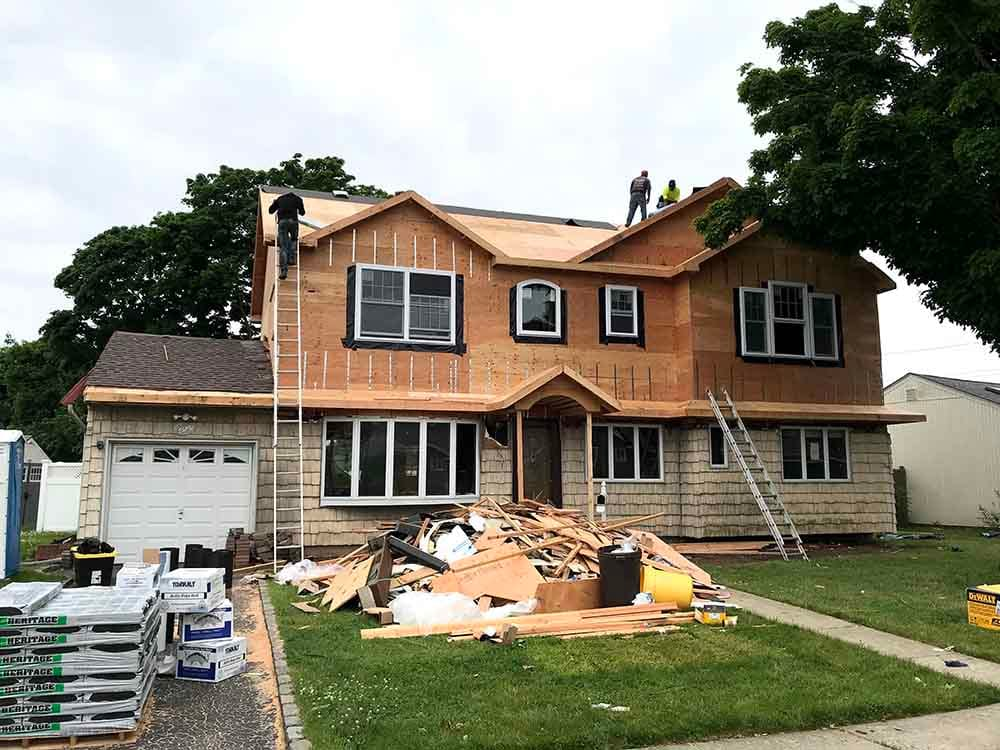

When a GTA house runs out of room, you can build up or build back. Both add real space, both need a permit and an engineer, and both are disruptive. They solve different problems, though, and the lot often makes the choice for you.

## The short version

| | Second storey | Rear addition |
| --- | --- | --- |
| Best for | Bedrooms and bathrooms | Kitchen, family room, main-floor bedroom |
| Typical size | 800–1,400 sq ft | 200–600 sq ft |
| Typical cost | $300,000–$600,000 | $150,000–$350,000 |
| Construction | 5–8 months | 4–6 months |
| Living at home | Usually not, for 2–3 months | Usually yes |
| Main zoning limits | Height, floor space index | Rear setback, lot coverage |

## Building up

A second storey on a bungalow is the most efficient way to add bedrooms. You double the floor area without giving up any yard, and the main floor can be left largely as it is, or reworked at the same time.

The hard parts are structural and logistical:

- **The house has to carry it.** An engineer checks whether the existing foundation and bearing walls can take a second floor. Often they can, with reinforcement. Sometimes new footings or steel beams are needed.
- **The roof comes off.** For a period of weeks the house is open to the weather. A good contractor schedules this stage for the drier months and has a protection plan ready.
- **A new stair.** It takes floor area on the main level, which affects the layout below.
- **Height limits.** The zoning by-law caps building height and often the depth of the second floor. In heritage districts, the design will also be reviewed for how it looks from the street.

## Building back

A rear addition extends the main floor into the yard. It’s the right choice when the problem is on the main floor: a kitchen too small for a family, no room to eat together, or a parent who needs a bedroom without stairs.

Things to check:

- **Rear yard setback and coverage.** These decide how far back you can go. Many GTA lots have less room than they appear to.
- **Foundation type.** A full basement under the addition costs more but adds usable space below. A crawl space or slab is cheaper.
- **Connection to the house.** The old rear wall becomes an interior wall, often with a beam to open the space. Getting the floor levels and the roofline right is what makes an addition look original.

## The hybrid

Many of the best additions combine the two: a rear extension on the main floor with a partial second storey above it for a primary suite or office. It avoids lifting the whole roof while still adding bedrooms.

## Costs that catch people out

- **Electrical service.** More space often pushes an older house past its panel capacity.
- **Heating and cooling.** A furnace sized for a bungalow will struggle with a second floor. A heat pump or a second system may be needed.
- **Matching the exterior.** Brick from the 1960s may not be available, and the new work may need a deliberate contrast instead.
- **Variance applications.** If the design exceeds the zoning limits, the Committee of Adjustment adds months and fees.

For a realistic schedule from first drawings to moving in, read [how long a home addition takes](/journal/how-long-does-home-addition-take-toronto). If you aren’t sure an addition is the right move at all, start with [renovate, add on, or rebuild?](/journal/renovate-add-or-rebuild).
