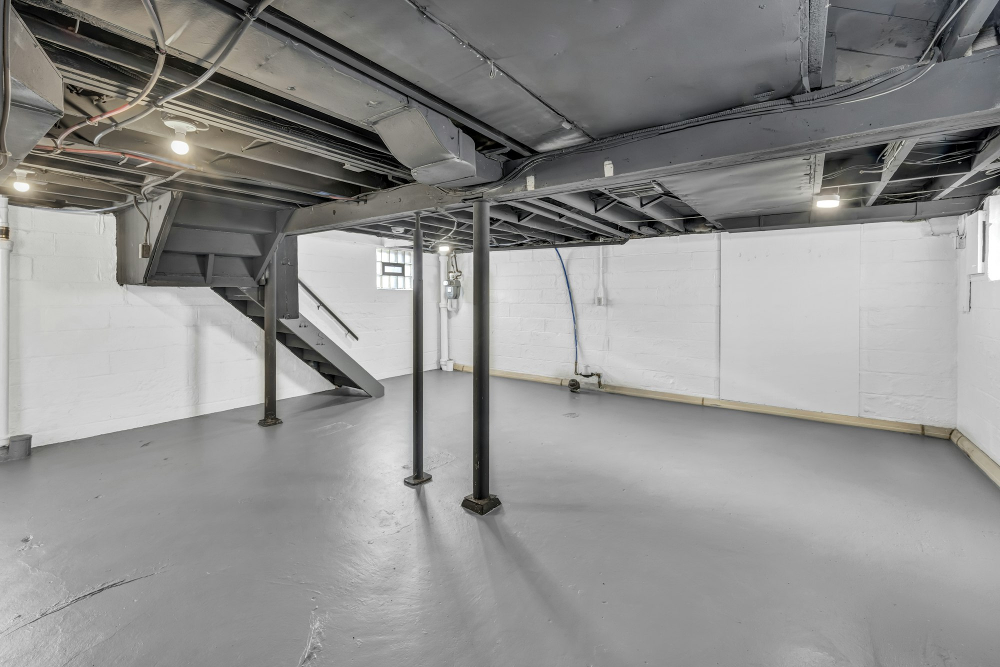

Since May 1, 2026, the City of Toronto pays up to **$6,650 per property** toward protecting a house from basement flooding, almost double the old maximum. The higher amounts also apply to eligible work completed on or after **November 12, 2025**, so if you installed a backwater valve or sump pump last winter, you may be able to claim the new rates.

If you’re finishing a basement or building a basement suite in Toronto, this is worth planning into the job. The devices protect the space you’re paying to finish.

## What the city pays

Each item is covered at up to 80 percent of the invoiced cost, including labour, materials and taxes, to these maximums:

| Work | Maximum subsidy |
| --- | --- |
| Home plumbing assessment by a licensed plumber | $500 (once) |
| Backwater valve and alarm | $1,600 per device, up to two devices |
| Sump pump and alarm | $2,250 |
| Battery backup for the sump pump | $300 |
| Severing and capping the foundation drain (weeping tile) connection | $400 |

The second backwater valve is new: houses with more than one sewer connection can now claim for both. The battery backup subsidy is also new, and it matters, because storms that flood basements often knock out the power that runs the sump pump.

## Who qualifies

- You own a single-family house, duplex, triplex or fourplex in the City of Toronto.
- Your downspouts are disconnected from the city sewer, or you have an exemption.
- Front-yard paving, including parking pads, complies with the zoning by-law.
- You have no outstanding taxes or debts owed to the city.
- Each property has a lifetime maximum for each type of work. The city can tell you whether yours has claimed before.

Subsidies are first-come, first-served and depend on the funding council approves each year.

## The rules that trip people up

- **A backwater valve needs a building permit** and an inspection before the floor is closed over it. Cover it before the inspection and the claim can be refused.
- **Your contractor needs a City of Toronto business licence** at the time of the work, and so does every subcontractor. Check before work starts with the city’s business licence lookup.
- **Invoices must be itemized.** If you install a sump pump with a battery backup, each needs its own line.
- **Photos are required** for a sump pump: the pump itself and the discharge pipe outside.
- **Apply within two years** of the installation.

## Why do it during a renovation

A backwater valve is installed in the main drain under the basement floor, which means cutting and patching the slab. If the basement is about to be finished, the floor is already open or easy to reach, and the cost of the work drops. The same goes for a sump pit. Adding them later, under new flooring, costs more and disrupts a finished room.

We plan flood protection into every basement project in Toronto: we pull the permit, book the inspection and itemize the invoice so the claim goes through. Read our [basement renovation cost guide](/journal/basement-renovation-cost-gta) for the bigger picture, or [send us your project details](/contact?service=basement-renovations).

Details here are from the City of Toronto’s program page as of November 2026. Confirm current amounts at toronto.ca before you rely on them.
