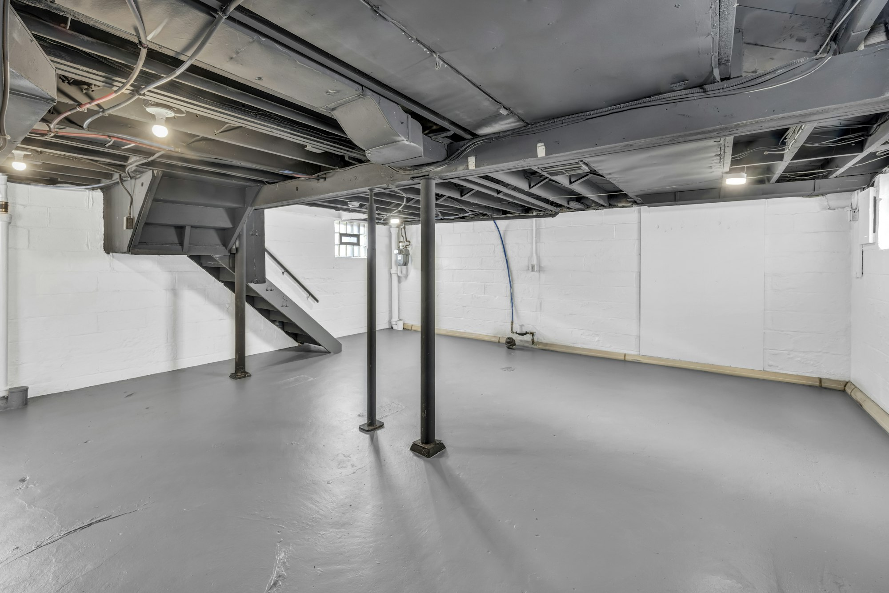

If you own a rental unit in Toronto and the renovation you’re planning means the tenant has to move out, you now need a city licence as well as a building permit. Toronto’s **Rental Renovation Licence Bylaw** applies whenever a landlord serves an **N13 notice** for repairs or renovations that need the unit empty, and the application is due **within seven days** of serving it.

The licence doesn’t decide whether you can end the tenancy; that’s still up to the Landlord and Tenant Board. But skipping it can lead to orders and charges, and enforcement has applied to N13s served since July 31, 2025.

## When you need one

- You serve an N13 to do work that requires vacant possession, **even if the tenant will return** afterward.
- One licence per rental unit.
- If the work can be done with the tenant in place, no N13 and no licence.
- Demolition isn’t covered; it goes through the city’s rental demolition process instead. In buildings with **six or more units**, changing the number of units or bedrooms can count as demolition even if the building stays up.

## Before you apply

You’ll need:

1. **The building permit** and any other permits for the work.
2. A **qualified person’s report**, from an architect (OAA) or engineer (PEO), confirming the work needs the unit empty.
3. A copy of the **N13 notice**.
4. The **fee: $728 per unit** in 2026.

## What the tenant is owed

| Tenant’s choice | Landlord provides |
| --- | --- |
| Returns after the work | Comparable temporary housing at a similar rent, **or** monthly rent-gap payments based on CMHC average market rents |
| Doesn’t return | A lump sum equal to **three months** of rent-gap payments, paid before the licence is issued |
| Either way | A moving allowance: **$1,500** for a studio or one-bedroom, **$2,500** for two bedrooms or more |

## The steps

1. **Apply within seven days of serving the N13**, with the permit, the N13, the qualified person’s report and the fee.
2. The city issues a **Tenant Information Notice** within two business days. Post it on the unit door within five days and email the city a photo within 14 days.
3. After a **14-day notification period**, submit a declaration signed by you and the tenant, plus a Tenant Accommodation Plan or Compensation Plan, or proof of the lump-sum payment.
4. The city **issues the licence**. Post it on the unit door during the work.
5. The licence is valid for **12 months**. If the work runs longer, apply again.

## Plan the schedule around it

The licence adds weeks before work can start, and the clock for the tenant’s temporary housing runs the whole time the unit is empty. Getting the permit drawings, the qualified person’s report and a realistic construction schedule ready before you serve the N13 keeps both short.

We renovate rental units and secondary suites across Toronto, and can provide the permit drawings and schedule you’ll need. [Tell us about your building](/contact?service=home-renovations). If you’re creating a new unit rather than renovating one, see [how many units you can build on your lot](/journal/how-many-units-on-your-lot-gta-2026).

Details are from the City of Toronto’s Rental Renovation Licence pages, November 2026. This is general information, not legal advice; landlords and tenants may want independent legal advice.
