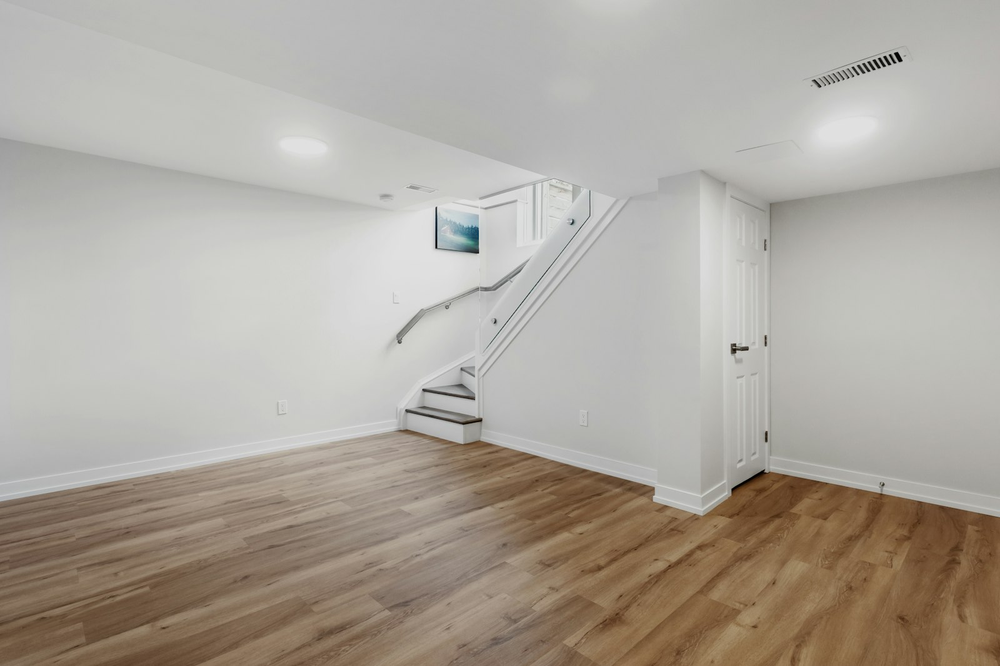

Thousands of GTA houses have a basement apartment that was never permitted. Many have been rented for years without trouble. Legalizing one is still worth doing: it protects your tenants, your insurance and your sale price, and since Ontario’s 2022 housing changes, second units are permitted as of right on most residential lots.

## Why legalize

- **Safety.** The requirements exist because basement fires are dangerous. Egress windows, fire separation and interconnected alarms save lives.
- **Insurance.** An unpermitted unit can complicate or void a claim.
- **Resale.** Buyers’ inspectors and lawyers increasingly flag unpermitted units, and buyers discount them.
- **Enforcement.** Existing two-unit houses are subject to the Ontario Fire Code, and the fire department can order upgrades after an inspection or complaint.

## What a legal unit needs

The exact requirements depend on whether the unit is being created in an existing house or built new, and the plans examiner confirms them for your house. The usual list:

- **Egress.** Each bedroom needs a window or door you can get out of, meeting minimum opening sizes, with a window well that leaves room to climb out.
- **Fire separation** between the units, usually with fire-rated drywall on ceilings and walls, solid doors, and sealed penetrations around pipes and ducts.
- **Interconnected smoke alarms** in both units, so an alarm in one sounds in both, and carbon monoxide alarms where there are fuel-burning appliances.
- **Ceiling height** that meets the code. For a unit in an existing house, the compliance alternatives generally allow about 1.95 m clear under beams and ducts.
- **Heating and ventilation** arranged so smoke can’t spread between units through shared ductwork, often with smoke dampers or separate systems.
- **Electrical** in good condition, with enough capacity for a second kitchen.
- **Entrance.** A separate entrance, or a shared one that meets the code for exits.
- **Zoning.** Setbacks and, in some cases, parking. Provincial rules limit how much parking a municipality can require.

## The steps

1. **Assessment.** We look at the unit against the requirements and list what needs to change.
2. **Drawings.** Existing and proposed layouts, showing fire separations, egress and alarms.
3. **Building permit.** Submitted to Toronto Building or your municipality’s building department.
4. **Construction.** Usually egress windows, fire separation, alarm wiring and any electrical or HVAC changes.
5. **Inspections.** Framing, fire separation, plumbing and final, plus ESA for electrical work.

## What it costs

A unit that already has good ceiling height, a separate entrance and sound electrical can often be legalized for **$20,000 to $50,000**. One that needs new egress windows cut into the foundation, a full fire separation, new wiring and HVAC changes can cost **$50,000 to $100,000** or more. If the ceiling is too low, lowering the floor is a separate and larger project; see [underpinning or bench footing](/journal/basement-underpinning-vs-bench-footing).

## Building new instead

If the basement is unfinished, building a legal unit from the start is simpler than legalizing one later. Read [what finishing a basement costs](/journal/basement-renovation-cost-gta) and [adding a second or third unit](/journal/additional-residential-units-york-region).
