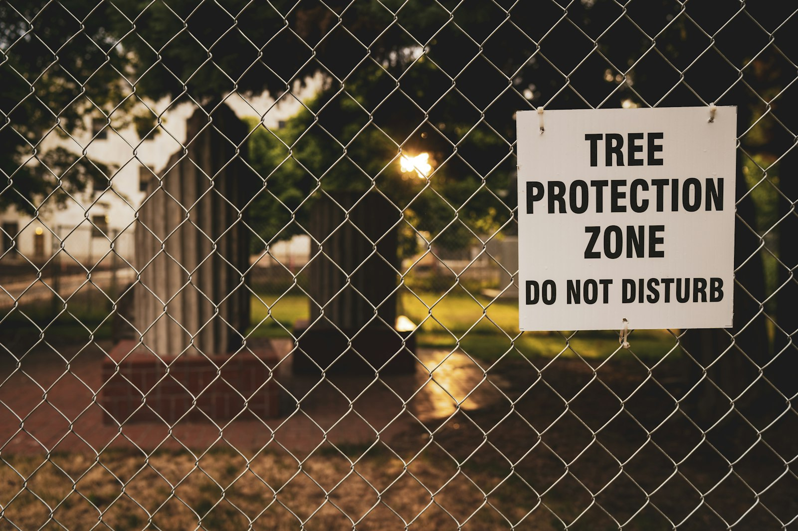

Trees decide more GTA construction projects than most homeowners expect. A protected tree on your lot, or your neighbour’s, can move a footprint, change a foundation, reroute a driveway or add months to a permit. Every municipality in the region protects private trees above a certain size, and the thresholds are different.

## The thresholds

| Municipality | Private trees protected from | Notes |
| --- | --- | --- |
| Toronto | 30 cm diameter | City-owned trees of any size are protected, and trees of any size in ravine-protected areas. |
| Markham | 20 cm diameter | Tree Preservation By-law 2023-164. |
| Vaughan | 20 cm diameter | Tree Protection By-law 052-2018, including multi-stem trees with a combined 20 cm. |
| Richmond Hill | 15 cm diameter | The current by-law lowered the threshold from 20 cm, which many older guides still quote. |

Diameter is measured at about chest height, 1.37 to 1.4 m above the ground depending on the by-law.

## It isn’t only about cutting trees down

The by-laws protect trees from injury, not just removal. Excavating for a foundation, an addition or a garden suite inside a tree’s root zone can count as injury. Trenching for new services, compacting soil with equipment and storing materials under the canopy can all damage roots.

That’s why tree protection usually starts with a **tree protection zone**: an area around the tree, sized by its diameter, fenced off with hoarding for the whole project. Nothing is stored, driven or dug inside it without approval.

## How it affects projects

- **Custom homes.** The new footprint may need to stay out of a tree protection zone. Sometimes that changes the design; sometimes the foundation is redesigned to bridge roots.
- **Additions.** A rear addition is often the project most affected, because the yard is where mature trees are.
- **Garden and laneway suites.** Many rear yards are small, and a single mature tree can make a suite impossible or force a smaller footprint.
- **Neighbours’ trees.** A tree that straddles the property line, or whose roots extend onto your lot, is protected too, and the neighbour may need to consent.

## The process, in general terms

1. **Survey the trees.** Locate and measure trees on the lot and within a few metres of it.
2. **Arborist report.** For construction projects, an arborist assesses each tree and recommends protection or removal.
3. **Apply.** Submit the permit application, the report and the site plan. Fees and replacement planting requirements vary.
4. **Install protection** before any work starts, and keep it in place until the end.

Markham, for example, states that it reviews tree permit applications within 45 days of payment. Build that into the schedule.

## Plan it early

The most expensive time to discover a protected tree is after the drawings are done. The cheapest is during feasibility, before the design is set. On our projects, a tree survey is one of the first things we look at.

Read more in our guides to [renovating, adding on, or rebuilding](/journal/renovate-add-or-rebuild) and [laneway and garden suite costs](/journal/laneway-suite-cost-toronto).
