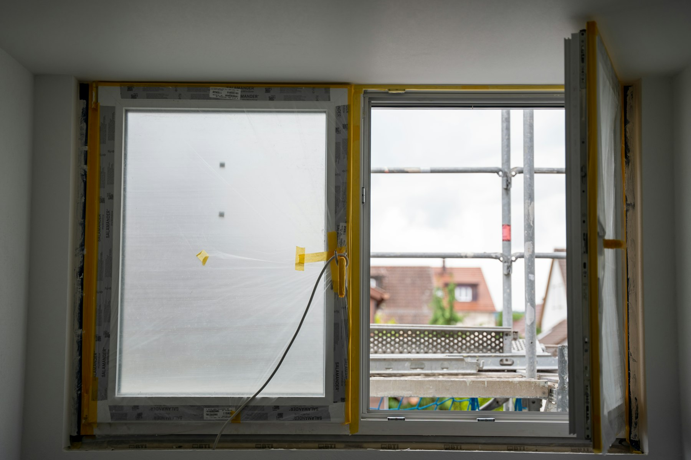
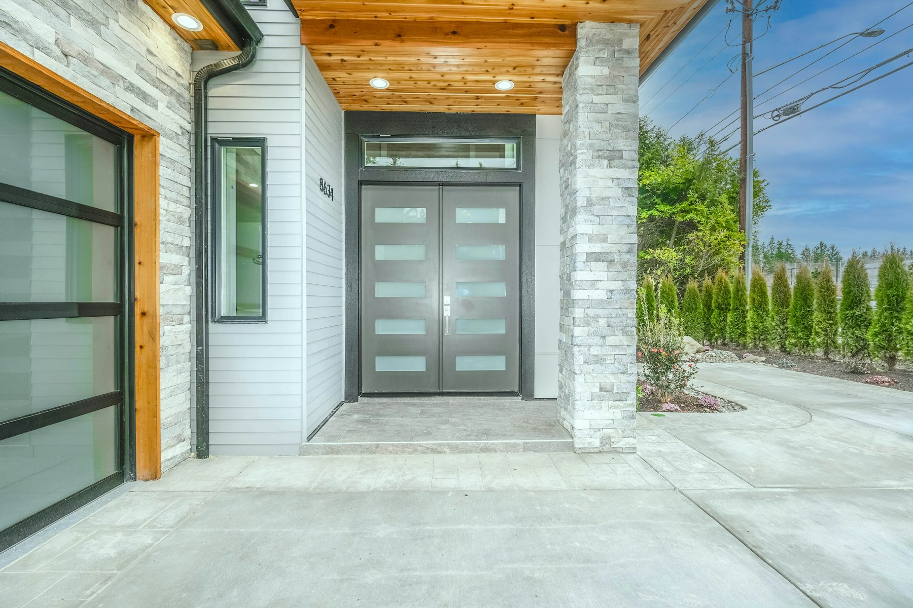

New windows and doors change how a house looks, feels and sounds, and how much it costs to heat. The product matters, but the installation decides whether they stay airtight and dry for the next 30 years.

## What drives the price

- **Frame material.** Vinyl is the most common and most affordable. Fibreglass is more stable and takes dark colours well. Aluminum-clad wood costs the most.
- **Glazing.** Double-pane low-E glass is standard; triple-pane adds cost but improves comfort and cuts street noise.
- **Size and shape.** Large, custom, arched and bay units cost more than standard sizes.
- **Installation type.** Full-frame replacement costs more than an insert, for reasons below.
- **Access.** Upper floors, brick openings and tight lots add labour.

## Typical costs

| Item | Installed, typical GTA range |
| --- | --- |
| Vinyl window, standard size | $800–$1,800 each |
| Fibreglass or aluminum-clad window | $1,500–$3,500 each |
| Patio sliding or swing door | $3,000–$7,000 |
| Entry door system with sidelights | $3,000–$12,000 |

These are planning ranges. A whole-house window replacement is usually priced per opening after a site visit, because the condition of the existing frames changes the scope.

## Insert or full-frame

An **insert** fits a new window inside the old frame. It’s faster and less disruptive, but the glass area shrinks slightly and any rot in the old frame stays hidden.

A **full-frame** replacement removes everything back to the rough opening. It lets the installer check for rot, re-flash the opening properly and insulate around the new window. It’s the better choice when frames are damaged, when the exterior trim is being replaced, or as part of a larger renovation.

## Installation is what lasts

Most window leaks come from installation, not the window. Ask how the opening will be flashed, including a sloped sill pan, how the gap will be sealed (low-expansion foam and tape, not just caulking), and who does the exterior capping and trim.

## Energy ratings

Look for ENERGY STAR certification for the Toronto climate zone, and compare the U-factor, where lower is better. Triple-pane glass helps most on north-facing walls and busy streets.

## Doors

Fibreglass entry doors resist denting and swelling and can mimic wood convincingly. Steel doors are secure and affordable but dent. Solid wood looks the best and needs the most maintenance. A multipoint lock and a well-adjusted threshold keep a door tight through winter.

## Permits and heritage districts

Replacing a window or door in the same opening usually doesn’t need a building permit. Making an opening larger, adding a new one or creating an egress window for a basement bedroom does. In heritage conservation districts, such as Unionville or Thornhill, changes to windows and doors visible from the street can need heritage approval as well.

## Rebates

Window and door rebates come and go. See our guide to [renovation rebates in Ontario](/journal/ontario-home-renovation-rebates), and confirm current eligibility before ordering.

## Questions to ask any installer

- Who manufactures the windows, and what does the warranty cover: the product, the installation, or both?
- Is this an insert or a full-frame replacement, and why?
- How will each opening be flashed and sealed?
- Who handles interior trim, exterior capping and disposal?
- What is the lead time? Custom windows often take six to ten weeks.

We supply and install windows and doors as part of our [trades](/services/trades) and [whole-home renovation](/services/home-renovations) work. [Send us your project details](/contact) for a written quote.
