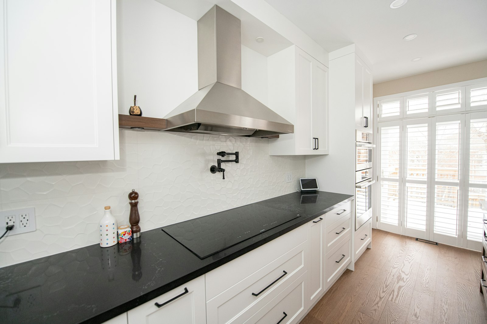

High-heat stir-frying, deep-frying and searing produce far more smoke, grease and moisture than most North American kitchens are designed for. In an open-concept house, a weak hood means the smell reaches the bedrooms and a film of grease settles on the cabinets.

Many families in Markham, Richmond Hill and across the GTA solve this with a **wok kitchen**: a second, enclosed cooking space, often next to the main kitchen or the garage, built for heavy cooking. Others upgrade the ventilation in a single kitchen. Either way, the principles are the same.

## Capture: the hood has to catch the smoke

A hood can only remove what it captures. That depends on its shape and position more than its fan.

- **Wider than the cooktop.** Ideally several inches past the burners on each side.
- **Deep enough.** It should cover the front burners, where the wok usually sits.
- **Low enough.** Around 24 to 30 inches above the cooking surface, within the manufacturer’s limits. A hood mounted too high for looks loses much of its capture.
- **A wall hood over an island hood.** A hood against a wall captures better than one floating over an island, where cross-drafts carry smoke away.
- **Baffle filters.** Stainless baffles handle grease better than mesh and go in the dishwasher.

## Capacity: how many CFM?

For heavy wok cooking, hoods in the range of **600 to 1,200 CFM** are common. More isn’t always better: a huge fan in a poorly shaped hood is loud and still lets smoke escape. Match capacity to the burners and the hood size.

A remote or inline blower, mounted in the attic, an exterior wall or the roof, moves most of the noise out of the kitchen.

## Ducting: the part people get wrong

- **Duct outside.** Recirculating hoods don’t remove smoke or moisture. A wok kitchen needs an exterior duct.
- **Size it to the hood.** Large hoods need large, smooth, rigid metal duct. Undersized or flexible duct kills performance.
- **Short and straight.** Every elbow costs airflow. Plan the hood location around the duct route, not the other way around.
- **A proper exterior cap** with a backdraft damper.

## Make-up air

A powerful hood pushes air out of the house, and the same amount of air has to come back in. In a tight, modern house, that air can be pulled down a chimney or a water heater vent, bringing exhaust gases with it.

In Ontario, whether you need dedicated make-up air depends on the house, particularly on whether any fuel-burning appliances rely on natural draft. If the furnace and water heater are sealed, direct-vent units, the risk is much lower. Many designers treat around 400 CFM as the practical point to plan for make-up air, and the building code requires it where exhaust could cause depressurization with certain appliances. Make-up air systems are interlocked with the hood and usually tempered so they don’t blow freezing air into the kitchen in January.

Plan this at design stage. Adding it later means new ductwork and electrical.

## Fire safety and finishes

- **Non-combustible surfaces** behind and beside the wok burner: stainless, porcelain slab, quartz or stone.
- **No open shelving or wood** close to the burner.
- **Easy-clean materials** everywhere: grease finds every grout line.
- **A fire extinguisher** within reach, and for a separate wok kitchen, a door that closes.

## Burners and gas

Residential wok burners are much stronger than standard burners. The gas line has to be sized for the total load of every appliance on it, which may mean a larger line from the meter. Gas work in Ontario must be done by a registered gas technician.

Induction is a real alternative. Induction woks and flat induction cooktops with a round-bottom wok adapter produce less waste heat, and some families use induction in the main kitchen and gas in the wok kitchen.

## A wok kitchen in practice

A typical layout: a compact room with a wall-mounted hood over a two- or three-burner gas cooktop, a stainless counter, a prep sink, tall pantry storage and tile or porcelain on the walls. It doesn’t need to be large, but it needs its own exterior wall for the duct.

If you’re planning a full kitchen renovation, read [what a kitchen renovation costs](/journal/kitchen-renovation-cost-gta) and [kitchen layouts for GTA homes](/journal/best-kitchen-layouts-gta-homes).
