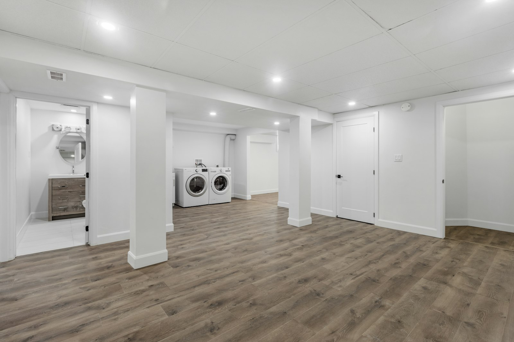

2022 年 11 月，安省通过了《加快建房法案》（Bill 23）。根据新规定，在有完整市政水电的城市住宅区，大多数独立屋、半独立屋和镇屋可以合法拥有**最多三个住宅单元**，例如：主屋 + 地下室单元 + 后院花园屋。

这对约克区的业主来说是个好消息：给父母住、给成年子女住，或者出租补贴房贷，都可以合法地做，而且**新增单元免收开发费**（Development Charges）。

## 合法单元需要满足什么？

城市分区规定允许您“可以建”，但单元本身还必须符合安省建筑法规，并申请建筑许可证。地下室单元通常需要：

- **逃生出口**：每间卧室要有符合尺寸要求、人能爬出去的窗户（或门），窗井要留出足够空间。
- **防火分隔**：两个单元之间要有防火分隔，一般使用防火石膏板，管线穿墙处要封堵。
- **联动烟雾报警器**：两个单元的烟雾报警器要联动，一处报警两处都响；有燃气设备的还要装一氧化碳报警器。
- **层高**：现有房屋改造的地下室单元，梁和风管下的净高一般要求约 1.95 米。
- **暖通**：要避免烟雾通过共用风管在两个单元之间扩散。
- **入口**：一般需要独立入口，常见做法是在侧院开一个下沉式入口。

如果层高不够，需要降低地面（Underpinning），这是单独的一笔较大费用。

## 大概多少钱？

| 情况 | 常见费用 |
| --- | --- |
| 未装修地下室，新建合法单元 | 12 万 – 20 万加元 |
| 已有出租单元，补办合法化 | 2 万 – 10 万加元 |
| 降低地面（Underpinning） | 8 万 – 15 万加元以上 |

## 流程

1. **上门评估**：看地下室的层高、防水、窗户、入口和电力容量。
2. **出图**：画出现有和改造后的平面图，标明防火分隔、逃生窗和报警器。
3. **申请许可证**：向万锦、列治文山或旺市的建筑部门递交申请。
4. **施工**：防水、开窗、防火分隔、厨房和浴室、电线和暖通。
5. **检查**：政府分阶段检查，电工部分由 ESA 检查。

## 给家人住，可以退税

如果新单元是给 65 岁以上的家人，或符合残疾税收抵免条件的成年家人居住，可以申请联邦的“多代同堂住宅改造税收抵免”（Multigenerational Home Renovation Tax Credit），可抵免最多 5 万加元合资格费用的 15%，即最多 7,500 加元。请保留所有发票，并向会计师确认资格。

## 为什么一定要合法？

没有许可证的出租单元，一旦发生火灾或漏水，保险理赔可能出问题；卖房时买家律师和验房师也会提出来压价。更重要的是，逃生窗和联动报警器真的能救命。

想评估您家地下室能不能做合法单元，欢迎[预约上门咨询](/zh#contact)，全程普通话沟通。
