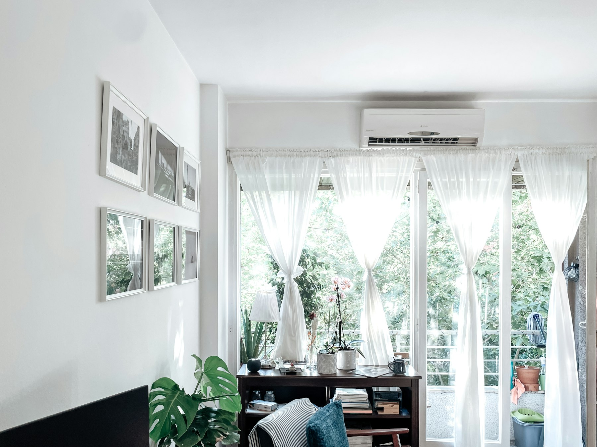

联邦政府新推出的全国热泵补贴（National Heat Pump Rebate），为全屋热泵提供 **2,000 加元**补贴，家庭收入低于中位数的最高可得 **10,000 加元**。网上申请将于 2027 年初开放，但补贴**追溯适用于 2026 年 11 月 1 日及之后的安装**。如果您家的炉子今年冬天该换了，现在就已经可以算进来。

## 补贴多少

| 家庭 | 补贴 |
| --- | --- |
| 税后收入高于本省中位数 | 2,000 加元 |
| 税后收入等于或低于中位数 | 最高 10,000 加元 |

安省按家庭人数的中位数标准为：1 人 46,981 加元，2 人 92,884 加元，3 人 119,850 加元，4 人 146,217 加元，5 人及以上 158,202 加元。税后收入为您 2025 年报税表第 23600 行减去第 43500 行，如有配偶或同居伴侣，两人相加。申请较高补贴时需要提供社会保险号（SIN），由加拿大税务局（CRA）核实收入。

## 谁符合条件

- 您是房屋业主，并居住在加拿大。不必是自住房，出租物业也可以。
- 热泵在计划的合格产品清单上，以 AHRI 编号识别。
- 由暖通（HVAC）承包商购买并安装。
- 热泵的功率足以为整栋房子供暖。
- 该地址以前没有领过联邦的热泵补贴。
- 每个家庭只能领一次，即使拥有多处房产。

您现在用什么采暖都可以（天然气、燃油、丙烷、电暖气或木材），不需要拆除旧系统，也不需要证明旧系统坏了。紧急更换和计划内升级都算。施工前后**都不需要做能效评估**。

## 要向承包商索取哪些单据

您需要在六个月内提交收据，而且计划对收据内容有具体要求：

- 申请人的姓名和地址
- 安装公司的名称
- 每台设备的品牌、型号和 **AHRI 编号**
- 安装的热泵数量
- 项目总费用，包括风管、电路升级等相关工程

现在就请承包商在发票上写清楚，几个月后再补会麻烦得多。

## 与安省补贴叠加

在安省，Home Renovation Savings 计划也为热泵提供最高 12,000 加元补贴，目前没有公布截止日期。详见[安省装修补贴与税务抵免](/zh/ontario-renovation-rebates)。两项补贴如何叠加，请在依赖之前分别向两个计划确认。

在多伦多，[家居节能贷款（HELP）](/zh/toronto-home-energy-loan)还可以借给您前期费用，通过地税账单分期偿还。

## 小心诈骗

政府提醒，有推销员打电话或上门，以这项补贴为名推销。加拿大环境与气候变化部不会打推销电话，也不会上门推销设备。请由您主动联系承包商。

## 您的房子适合装热泵吗？

对于用天然气采暖的房子，热泵不一定能降低采暖费用；老房子可能需要先做保温、气密或电力扩容。我们会在装修时把热泵和保温、电路工程一起规划，并确保发票包含补贴要求的全部信息。[告诉我们您的项目](/zh/contact?service=home-renovations)。

本文信息来自加拿大政府全国热泵补贴页面（2026 年 11 月 5 日更新）。计划细则仍在制定中，正式推出前可能会有变化。
