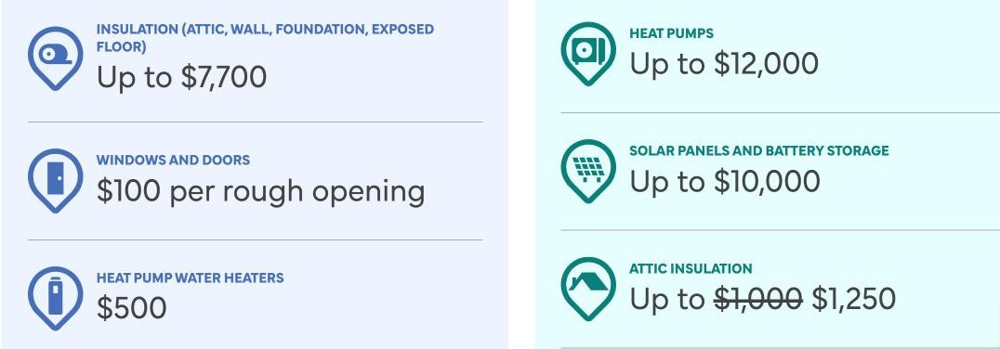
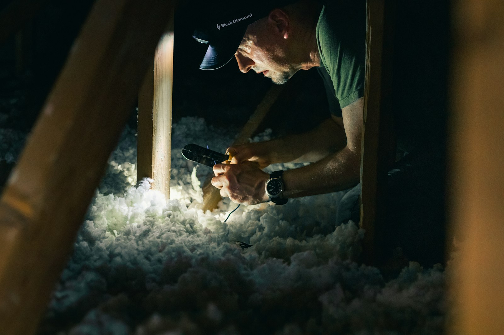

安省最主要的装修补贴是 Home Renovation Savings（家居装修节能补贴）计划，由 Enbridge Gas 和 Save on Energy 联合推出、安省政府支持。热泵最多补贴 12,000 加元，保温最多 7,700 加元，每扇新窗或新门 100 加元，而且其中几项补贴的**截止日期是 2026 年 11 月 30 日**。

补贴很少能覆盖整个装修，但加上联邦税务抵免，在保温、热泵、门窗和给家人住的出租单元上，可以省下几千加元。关键在于时机：好几个项目都要求在开工之前就采取行动。各项计划经常变化，请把本文当作参考，申请前向各计划确认最新细节。

## Home Renovation Savings：补贴多少

| 项目 | 最高补贴 | 是否需要能效评估 |
| --- | --- | --- |
| 保温（阁楼、外墙、地基、外露楼板） | 7,700 加元 | 需要 |
| 门窗 | 每个洞口 100 加元 | 需要 |
| 热泵热水器 | 500 加元 | 需要 |
| 气密 | 250 加元 | 需要 |
| 热泵 | 12,000 加元 | 不需要 |
| 太阳能板和储能电池 | 10,000 加元 | 不需要 |
| 阁楼保温 | 1,250 加元 | 不需要 |
| 智能温控器 | 125 加元 | 不需要 |

需要评估的项目，必须**至少做两项升级**才能申请，所以门窗不能单独申请。施工前后各做一次能效评估，而且第一次评估**必须在开工之前完成**。如果是全屋翻新，这条路线通常很划算。

## 谁符合条件

- 您是房屋业主。
- 您是 Enbridge Gas 用户，主要用天然气炉或锅炉采暖；或者接入安省电网，用电、燃油、丙烷或木材采暖。
- 独立屋、半独立屋、镇屋（不含叠拼镇屋）或永久地基上的移动房屋。
- 入住不满六个月的新房不符合条件。

## 2026 年截止日期

计划条款为今年规定了明确的期限：

- **需要能效评估的项目：**施工后的第二次评估必须在 **2026 年 11 月 30 日前预约**，并在 2026 年 12 月 31 日前完成；如果第一次评估后 180 天更早到期，则以 180 天为准。
- **免评估的阁楼保温：**必须由参与计划的承包商在 **2026 年 11 月 30 日前完工**。
- **智能温控器补贴：**2026 年 12 月 31 日结束。
- **热泵、太阳能板和储能电池：**目前没有公布截止日期，按预算先到先得，用完为止。

计划还没有公布 2026 年之后的安排。一有消息，我们会更新本文。

## 现在该做什么

1. **已经做过第一次评估的：**马上预约第二次评估，确保 11 月 30 日前录入系统。
2. **想做阁楼保温的：**这个月内请参与计划的承包商完工。
3. **还没开始的：**需要评估的路线今年已经来不及了，但热泵目前还没有截止日期。
4. **小心诈骗：**计划官网提醒，有人冒充官方网站和参与计划的承包商。只通过 homerenovationsavings.ca 申请。

## 联邦税务抵免

**多代同堂住宅装修税务抵免**（Multigenerational Home Renovation Tax Credit）。如果您加建一个单元，让 65 岁以上的家人或符合残障税务抵免条件的成年家人与您同住，可以按最多 50,000 加元合格费用的 15% 申请抵免，最多 7,500 加元。地下室单元、加建和花园屋都适用。

**住宅无障碍税务抵免**（Home Accessibility Tax Credit）。为 65 岁以上或符合残障税务抵免条件的人，让住宅更安全、更方便的装修，每年最多 20,000 加元费用可按 15% 抵免。坡道、扶手、步入式淋浴、加宽门洞和楼梯升降椅都是常见例子。

请保留每一张发票，并向会计师确认是否符合条件。

## 新增单元免收开发费

这不是补贴，但能省一大笔：根据安省 2022 年的住房新规，房屋内的第二、第三个单元，以及附属建筑中的一个新增单元，免收开发费。详见[合法地下室出租单元中文指南](/zh/basement-rental-unit)。

## 市政府的项目

在多伦多，最大的是地下室防水补贴，现在每处房产最多 6,650 加元，涵盖止回阀、集水坑泵等工程。详见[多伦多地下室防水补贴](/zh/toronto-flooding-subsidy)。

有些城市还提供通过地税账单偿还的低息节能改造贷款，以及面向低收入和残障业主的维修项目。每年情况不同，规划前请向所在城市确认。

## 加建单元的资金

如果您要加建地下室单元或花园屋，CMHC 担保的再融资可以按加建完成后的房屋价值贷款。详见[用房贷加建出租单元](/zh/secondary-suite-financing)。

## 已经结束的项目

联邦的 Canada Greener Homes Grant（绿色家园补贴）已于 2024 年停止接受新申请，但一些旧文章仍在介绍它。如果承包商的报价是按这笔补贴算的，请让对方核实。

联邦“加拿大二级单元贷款计划”在 2024 年宣布时为最多 8 万加元、年利率 2% 的贷款，但从未开放申请，并已在 2025 年联邦预算中取消。网上仍有帖子说可以申请。

## 怎样拿到最多补贴

1. **尽早决定**哪些节能升级要纳入装修。
2. 如果走需要评估的路线，**在拆除之前做能效评估**。
3. **保留文件：**发票、产品型号和安装日期。
4. **请承包商在发票上把符合条件的工程单独列出。**

我们会在规划阶段指出可以申请补贴的地方，并分项开具发票，方便您申请。如果您要翻新老房子，保温和气密往往是解决漏风问题最便宜的时机。可以先看看我们的[装修费用中文指南](/zh/renovation-cost-guide)，或者[联系我们](/zh/contact?service=home-renovations)。

本文的计划信息来自 Home Renovation Savings 官网及其条款文件（2026 年 11 月）。
