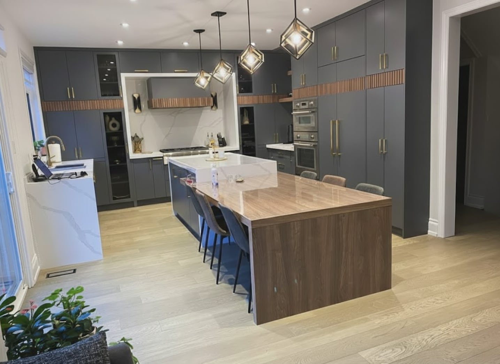

很多业主在找装修公司之前，最想知道的就是“大概要多少钱”。下面是我们在大多伦多地区（GTA）实际报价中常见的费用区间，均为税前价格（安省 HST 为 13%），不含家电。

## 各类项目费用一览

| 项目 | 常见费用 |
| --- | --- |
| 厨房翻新（格局不变） | 4.5 万 – 9 万加元 |
| 厨房翻新（拆墙、移水电、定制橱柜） | 9 万 – 15 万加元以上 |
| 普通浴室全面翻新 | 2.5 万 – 4.5 万加元 |
| 主卧套房浴室 | 4.5 万 – 9 万加元 |
| 地下室装修 | 每平方英尺 70 – 110 加元 |
| 地下室合法出租单元 | 12 万 – 20 万加元 |
| 房屋加建 | 每平方英尺 350 – 600 加元 |
| 后巷屋 / 花园屋 | 35 万 – 60 万加元 |
| 拆旧建新定制住宅 | 每平方英尺 400 – 700 加元以上（不含土地） |

每个项目的情况都不同，以上区间只用于前期规划。准确价格要在我们上门看过房子之后，以书面分项报价为准。

## 为什么同样的厨房报价差这么多？

**格局是否改变。**水槽、炉灶换位置意味着重新做下水、通气管或煤气管；拆承重墙需要结构工程师设计横梁，并申请建筑许可证。这些“看不见”的工程，才是造价拉开差距的主要原因。

**橱柜。**橱柜通常占厨房预算的 30% – 40%。通顶高柜、定制尺寸、柜内灯光都会增加费用。

**排烟。**中式烹饪油烟大，需要大风量、直排室外的烟机。风量较大的烟机可能还需要补风系统。详见[中式爆炒厨房怎么做](/zh/wok-kitchen)。

**房龄。**1960 年以前的老房子，打开墙后常见旧式电线、镀锌水管、石棉等问题。建议预留 10% 左右的应急预算。

## 报价时一定要问清楚

1. 报价是否分项列明？哪些是“预留金额”（allowance）？
2. 家电、灯具、五金是否包含在内？
3. 谁负责申请建筑许可证？
4. 拆墙后发现问题怎么处理？是否先报价、经您书面同意再施工？
5. 是否有商业责任保险和 WSIB 工伤保险证明？
6. 付款方式是否按完成的工程阶段付款，而不是按日期？

## 我们的做法

我们提供书面分项报价，未定的材料以预留金额逐项列出；任何变更先报价、经您书面确认后才施工；许可证和政府检查由我们负责。全程可用普通话沟通。

如果您正在规划项目，欢迎[预约上门咨询](/zh#contact)。
