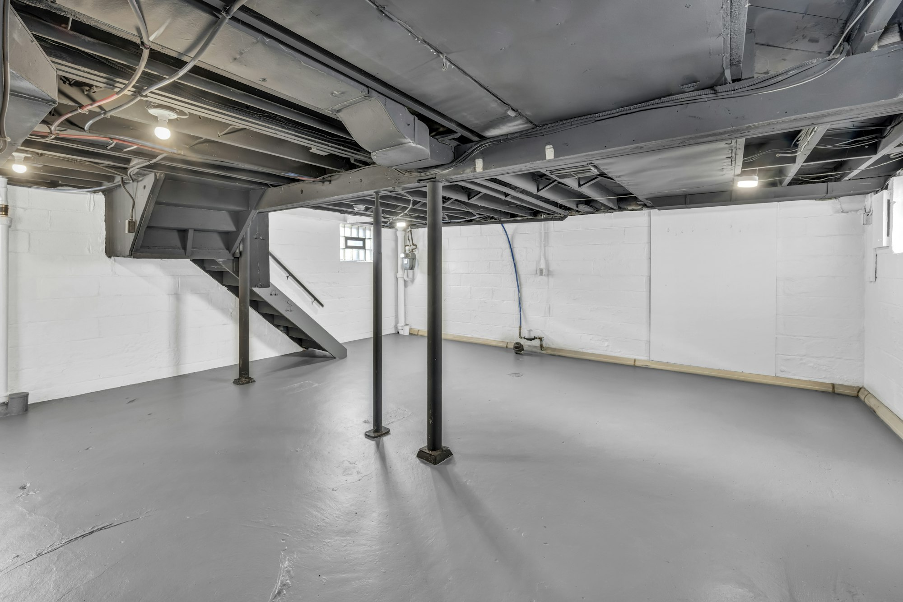

从 2026 年 5 月 1 日起，多伦多市为每处房产提供**最多 6,650 加元**的地下室防水补贴，比原来的上限几乎翻了一倍。新的补贴标准同样适用于 **2025 年 11 月 12 日**及之后完成的合格工程。如果您去年冬天装了止回阀（backwater valve）或集水坑泵（sump pump），很可能可以按新标准申请。

如果您打算在多伦多装修地下室或做地下室出租单元，这笔补贴值得一起规划。这些设备保护的，正是您花钱装修的空间。

## 补贴多少

每一项按发票金额（含人工、材料和税）补贴最多 80%，上限如下：

| 项目 | 最高补贴 |
| --- | --- |
| 持牌水管工上门做家庭水管检查 | 500 加元（一次） |
| 止回阀及报警器 | 每个 1,600 加元，最多两个 |
| 集水坑泵及报警器 | 2,250 加元 |
| 集水坑泵备用电池 | 300 加元 |
| 切断并封堵地基排水管（weeping tile）与市政下水道的连接 | 400 加元 |

第二个止回阀是新增的：有多个下水道接口的房子，现在两个都可以申请。备用电池补贴也是新增的，而且很实用，因为导致地下室进水的暴雨，往往也会让集水坑泵断电。

## 谁符合条件

- 您是多伦多市内独立屋、双拼、三拼或四拼住宅（duplex、triplex、fourplex）的登记业主。
- 屋顶落水管已与市政下水道断开，或已获得豁免。
- 前院铺装（包括停车位）符合分区规定。
- 没有拖欠市政府的税款或其他欠款。
- 每处房产每类项目都有终身补贴上限。可以向市政府查询您的房子以前是否申请过。

补贴先到先得，并取决于市议会每年批准的预算。

## 最容易出问题的地方

- **安装止回阀需要建筑许可证**，并且必须在地面封闭之前通过检查。检查前就封上，补贴可能会被拒。
- **承包商必须持有多伦多市营业执照**（business licence），每一个分包商也一样。开工前请用市政府的营业执照查询工具核实。
- **发票必须分项列明。**如果集水坑泵和备用电池一起装，两项要分开写。
- **集水坑泵需要拍照**：泵本身，以及屋外的排水管。
- **安装后两年内申请。**

## 为什么在装修时一起做

止回阀装在地下室地面以下的主排水管上，需要切开再修补混凝土地面。如果地下室正准备装修，地面本来就要处理，成本会低很多。集水坑也是一样。等装修完再加，就要拆新地板，花得更多，也更麻烦。

我们在多伦多做的每一个地下室项目，都会把防水设备一起规划：申请许可证、预约检查、分项开具发票，让补贴顺利申请下来。也可以看看我们的[地下室出租单元中文指南](/zh/basement-rental-unit)，或者[把项目情况发给我们](/zh/contact?service=basement-renovations)。

本文信息来自多伦多市政府项目页面（2026 年 11 月）。申请前请在 toronto.ca 确认最新金额。
