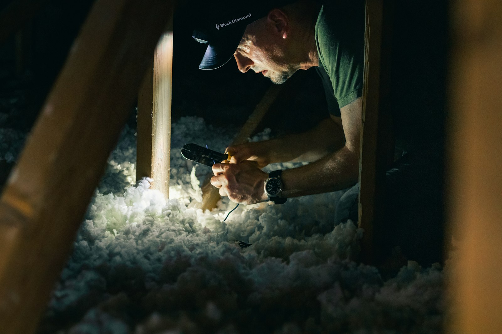

多伦多市的家居节能贷款计划（Home Energy Loan Program，简称 HELP）为房主提供**最高 125,000 加元**的节能改造贷款，**固定利率**，最长 20 年，通过地税账单分期偿还。承包商由您自己选择，开工前市政府最多可预付 30% 的款项。它和补贴很搭配：贷款先解决前期费用，补贴之后再到账。

## 可以用在哪些项目上

热泵、地源热泵、保温（地下室、阁楼和外墙）、气密、更换门窗、高效炉子、锅炉、空调和热水器、屋顶太阳能板、储能电池、太阳能热水、排水余热回收、节水马桶，以及二级电动车充电桩。

## 利率和期限

利率在整个期限内固定，适用于 **2026 年 12 月 31 日**前办理的贷款：

| 期限 | 固定利率 |
| --- | --- |
| 5 年 | 3.83% |
| 10 年 | 4.43% |
| 15 年 | 4.85% |
| 20 年 | 5.12% |

包含太阳能、门窗、地源热泵或热泵的项目可以选 20 年期。另加 2% 的行政费用，贷款总额不能超过 125,000 加元或房产现值评估（CVA）的 10%，以较低者为准。可以随时提前还清；贷款附在房产上，而不是附在个人名下。

## 谁符合条件

- 您拥有多伦多市内的独立屋、半独立屋、联排屋、双拼、三拼，或最多三层、六个单元的低层住宅（邮编以 M 开头）。
- 房产证上的所有业主都同意参加。
- 过去三年内，地税或水电费逾期 60 天的次数不超过三次。
- 如有房贷，需要贷款银行书面同意，市政府会把表格寄给您。

## 流程

1. **网上申请。**在银行同意后，市政府会在五到七个工作日内给出贷款额度。
2. **请注册能效评估师做能效评估**，再找承包商报价，提交资金申请。只装热泵或只装太阳能的项目不需要能效评估。
3. **签署业主协议。**之后市政府最多可预付 30% 的款项。
4. **完成工程**，做施工后的评估（热泵项目由安装商签署证明表），提交发票，市政府支付余款。
5. **还款**：每年 11 期，随地税账单扣款。

选择承包商和申请许可证由您负责，所以请选择发票分项清楚、并会负责办理许可证的承包商。

## 与补贴叠加

HELP 可以和市、省、联邦及公用事业公司的补贴一起使用。[全国热泵补贴](/zh/national-heat-pump-rebate)对 2026 年 11 月 1 日起安装的热泵最高补贴 10,000 加元；安省 Home Renovation Savings 计划涵盖保温、门窗和热泵，详见[安省装修补贴与税务抵免](/zh/ontario-renovation-rebates)。

我们在多伦多的装修项目中会把节能改造一起规划，并提供 HELP 要求的分项报价和发票。[告诉我们您的项目](/zh/contact?service=home-renovations)。

本文信息来自多伦多市家居节能贷款计划页面（2026 年 11 月）。2026 年 12 月 31 日之后的利率可能会变化。
