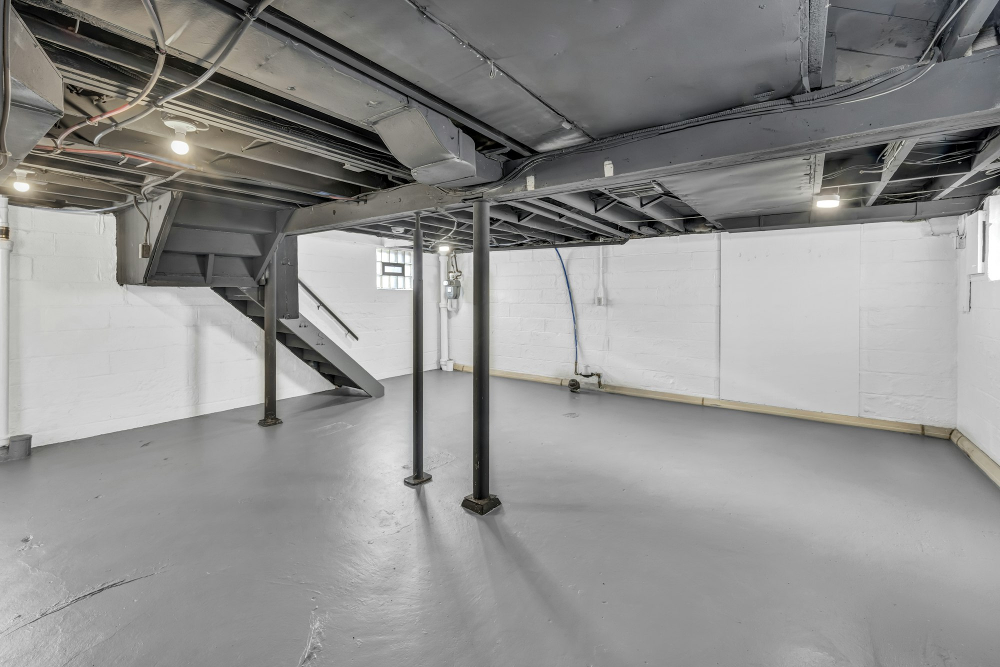

如果您在多伦多有出租单元，计划的装修需要租客搬出，那么现在除了建筑许可证，还需要一张市政府执照。多伦多的**出租装修执照条例**（Rental Renovation Licence Bylaw）适用于房东为需要空置单元的维修或装修而发出 **N13 通知**的情况，申请必须在发出通知后**七天内**提交。

这张执照并不决定您能否终止租约，那仍由房东与租客委员会（Landlord and Tenant Board）决定。但不申请可能会被下令整改或起诉，自 2025 年 7 月 31 日起发出的 N13 通知都适用。

## 什么时候需要

- 您发出 N13 通知，进行需要空置单元的工程，**即使租客之后会搬回来**。
- 每个出租单元一张执照。
- 如果租客住在里面也能施工，就不需要 N13，也不需要执照。
- 拆除不在此列，需走市政府的出租房拆除流程。在**六个单元及以上**的楼里，改变单元数或卧室数，即使楼没拆，也可能被视为拆除。

## 申请前要准备

1. **建筑许可证**及工程所需的其他许可证。
2. 由建筑师（OAA）或工程师（PEO）出具的**专业人士报告**，确认工程需要空置单元。
3. **N13 通知**副本。
4. **申请费：2026 年每个单元 728 加元。**

## 租客应得的安排

| 租客的选择 | 房东需要提供 |
| --- | --- |
| 工程完成后搬回 | 租金相近的同类临时住房，**或**按 CMHC 平均市场租金计算的每月租金差额补助 |
| 不搬回 | 相当于**三个月**租金差额的一次性补偿，在执照发出前付清 |
| 两种情况都要 | 搬家补助：单间或一房 **1,500 加元**，两房及以上 **2,500 加元** |

## 流程

1. 在发出 N13 后**七天内申请**，附上许可证、N13、专业人士报告和费用。
2. 市政府在两个工作日内发出**租客通知书**（Tenant Information Notice）。您需要在五天内贴在单元门上，并在 14 天内把照片发邮件给市政府。
3. **14 天通知期**过后，提交您和租客签字的声明，以及租客安置计划或补偿计划，或一次性补偿的付款证明。
4. 市政府**发出执照**，施工期间张贴在单元门上。
5. 执照有效期 **12 个月**，工程超时需要重新申请。

## 围绕执照安排工期

执照会让开工推迟几周，而租客临时住房的费用在单元空置期间一直在计。在发出 N13 之前，先准备好许可证图纸、专业人士报告和切实的施工时间表，两段时间都能缩短。

我们在多伦多各地翻新出租单元和地下室单元，可以提供您需要的许可证图纸和工期安排。[告诉我们您的房子](/zh/contact?service=home-renovations)。如果您是要新增单元而不是翻新，请看[一块地能建几个单元](/zh/units-per-lot-2026)。

本文信息来自多伦多市出租装修执照页面（2026 年 11 月）。本文仅为一般信息，不构成法律建议；房东和租客可能需要寻求独立的法律意见。
