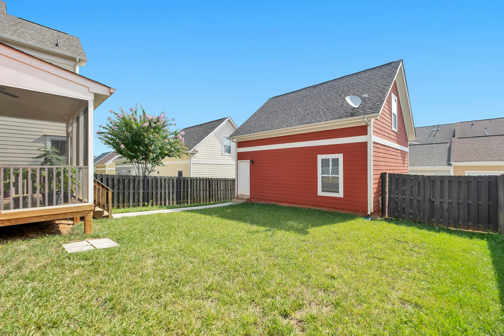

过去四年，一块住宅地上能建几个单元的规定，变化比之前四十年还大。现在各个城市的规定也不一样了，而且今年春天还有一项政策被撤回。下面是截至 2026 年底，我们最常施工的几个城市的情况。

## 全省基本规定：三个单元

自 2022 年 11 月安省通过《加快建房法案》（Bill 23）以来，大多数有完整市政水电的城市住宅地块，**无需改变分区即可拥有最多三个住宅单元**：例如主屋、地下室单元和后院花园屋。大多伦多地区每个城市都必须允许。

这些新增单元还**免收开发费**：独立屋、半独立屋或镇屋内的第二、第三个单元，以及花园屋等附属建筑中的一个单元。

## 多伦多：全市四个单元，部分选区六个

- **多单元住宅（multiplex）：**从 2023 年起，多伦多全市的住宅地块都允许最多**四个单元**。
- **六拼（sixplex）：**2025 年 6 月，市议会批准在九个选区无需改分区即可建最多**六个单元**：多伦多及东约克区（Toronto and East York）的八个选区（Parkdale-High Park、Davenport、Spadina-Fort York、University-Rosedale、Toronto-St. Paul’s、Toronto Centre、Toronto-Danforth、Beaches-East York），以及士嘉堡北区（第 23 选区）。其他选区以后可以选择加入。
- **花园屋和后巷屋**分别从 2022 年和 2018 年起允许建造，有各自的面积、退界和消防通道要求。

## 万锦：三个单元，四拼政策被否决

万锦市议会曾通过一项政策，允许许多地块建最多四个单元。**2026 年 3 月，市长动用“强市长权力”撤销了这项决定**，理由是会给道路、停车和市政设施带来压力。全省“三个单元”的基本规定仍然适用，所以主屋加地下室单元再加花园屋仍然可以；第四个单元则需要改分区。

如果您今年早些时候看到“万锦现在可以建四拼”的帖子，那已经过时了。

## 列治文山和旺市：三个单元

两个城市都允许全省规定的三个单元，并按各自的分区规定限制面积、高度、停车和退界。两市都还没有允许无需改分区建四个单元。

**旺市**市议会在 2026 年 4 月投票决定暂时降低住宅开发费。新增单元本来就免收开发费，但如果您在旺市计划新建定制住宅或较大的项目，请向市政府确认申请许可证时适用的收费标准。

## 规划第三、第四个单元之前

1. **先查您地块的分区。**“无需改分区”不代表什么都可以：高度、退界、覆盖率、停车，以及花园屋与主屋的距离和消防通道，都仍然要符合规定。
2. **查水电容量。**单元增多，供水、下水道和电力往往需要升级。
3. **查树木。**受保护的树木可能让花园屋无处可建。
4. **规划好资金。**CMHC 担保的再融资可以按完工后的房屋价值为加建单元提供贷款。详见[用房贷加建出租单元](/zh/secondary-suite-financing)。

## 接下来

地下室单元的具体要求，请看我们的[地下室出租单元中文指南](/zh/basement-rental-unit)；后院小屋请看[后巷屋与花园屋](/zh/services/laneway-garden-suites)。

在您支付设计费之前，我们会先核查您地块的分区、树木和水电。[把地址发给我们](/zh/contact?service=laneway-garden-suites)，我们告诉您能建什么。

本文内容反映截至 2026 年 11 月公开报道的市议会决定。分区规定经常变化，动工前请向市政府确认。
