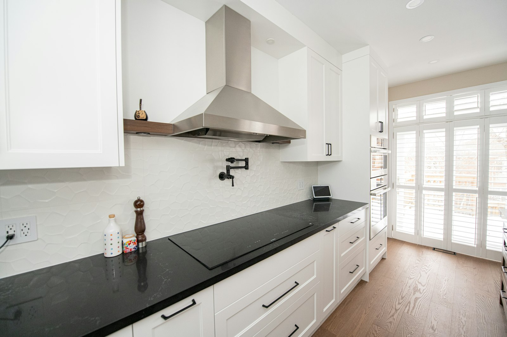

北美的房子大多按西式烹饪设计：烟机风量小、开放式厨房连着客厅。中式爆炒、油炸产生的油烟远超这种设计的承受能力，结果就是满屋油烟味、橱柜表面一层油。

很多万锦、列治文山的家庭会单独做一个**爆炒厨房**（也叫第二厨房、Spice Kitchen），专门用来做重油重火的菜；也有家庭只在主厨房升级排烟。无论哪种，原则都一样。

## 一、烟机要“罩得住”

烟机能排走多少油烟，首先取决于它能不能把烟“罩住”，而不只是风量大小。

- **比灶台宽**：最好左右各超出几英寸。
- **够深**：要能罩住前排炉头，炒锅通常放在前排。
- **安装高度合适**：一般离灶面 24 – 30 英寸，以厂家要求为准。为了好看装得太高，效果会大打折扣。
- **靠墙比岛台好**：岛台上方的烟机容易受横向气流影响，油烟会被吹散。
- **用不锈钢挡板式滤网**：比金属网更耐油，可以放进洗碗机清洗。

## 二、风量选多大？

重度爆炒的厨房，常见风量在 **600 – 1200 CFM** 之间。风量不是越大越好：罩子形状不对，风量再大也只是更吵。外置或管道式风机可以把噪音移到阁楼、外墙或屋顶。

## 三、风管是关键

- **必须直排室外**，内循环烟机去不了油烟和水汽。
- **管径要够大**，用光滑的硬质金属管，不要用软管。
- **越短越直越好**，每个弯头都会损失风量。最好先确定风管路线，再定灶台位置。
- **室外出风口要有防倒灌风门。**

## 四、什么时候需要补风？

烟机往外排多少空气，就要有多少空气补进来。在密封性好的新房子里，大风量烟机可能会把炉子、热水器烟道里的废气倒抽回室内，这是有安全隐患的。

在安省，是否需要专门的补风系统，主要看家里的燃气设备怎么排气：如果炉子和热水器都是密闭直排式，风险小很多；如果有依靠自然抽力排烟的设备，大风量烟机就可能需要补风。很多设计师以约 400 CFM 作为需要考虑补风的参考值。补风系统一般与烟机联动，冬天还需要加热，避免把零下的冷风直接吹进厨房。

这些都要在设计阶段定好，后期再加需要重新走风管和电线。

## 五、防火与材料

- 炉头周围用**不可燃材料**：不锈钢、瓷砖大板、石英石或天然石材。
- 炉头附近**不要放开放式木隔板**。
- 所有表面选**好清洁**的材料，油会钻进每一条砖缝。
- 备好灭火器；独立的爆炒厨房最好有门可以关上。

## 六、煤气管道

家用猛火炉头比普通炉头功率大得多，煤气管必须按全屋燃气设备的总负荷来配，有时需要从煤气表重新拉更粗的管。在安省，煤气工程必须由持牌燃气技师施工。

电磁炉也是不错的选择：圆底锅专用的电磁炉热损失小、油烟相对少。不少家庭主厨房用电磁炉，爆炒厨房用煤气。

## 一个典型的爆炒厨房

一间不大的房间，靠外墙安装烟机，两到三个炉头的燃气灶，不锈钢台面，一个小水槽，高柜储物，墙面贴瓷砖。面积不需要很大，但一定要有一面外墙用来出风管。

想了解整体预算，请看[2026 年大多伦多装修费用参考](/zh/renovation-cost-guide)，或直接[预约上门咨询](/zh#contact)。
